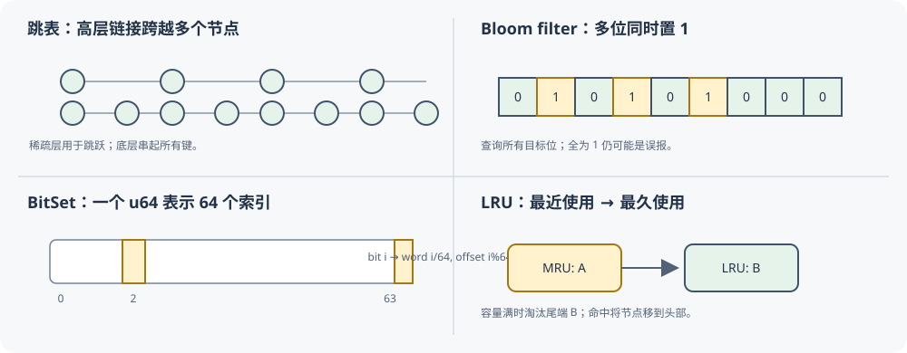

# 高级与组合结构

本章介绍围绕特定约束设计的结构：用随机层级维护有序索引、用概率换取紧凑成员过滤、用位数组表示整数集合、用结构共享保留历史版本，以及组合哈希索引与链维护缓存淘汰顺序。

它们的选择依赖问题本身：是否允许误报、索引域是否密集且有界、是否需要旧版本、容量是否固定、是否需要根据访问热度淘汰数据。

::: {.callout-tip}
## 学完本章，你应该能够

- 区分跳表的期望复杂度与最坏复杂度。
- 解释 Bloom filter 的无假阴性保证、误报可能性与容量参数。
- 根据最大索引估算 BitSet 的空间，而非只看元素数量。
- 描述持久化更新如何复制路径并共享未修改子树。
- 追踪 LRU 命中、更新、淘汰和零容量行为。
:::

{#fig-advanced-structures width=100%}

## 跳表：随机层级的有序索引

`SkipListMap<K, V>` 在有序链表上叠加多层前向链接。每个节点随机取得高度：底层包含所有节点，更高层逐渐稀疏。查找从高层开始，沿着不会越过目标的链接前进，无法继续时下降一层。插入与删除在各层更新前驱链接。

```rust
use data_structures::SkipListMap;

let mut scores = SkipListMap::with_seed(7);
scores.insert("Ada", 10);
scores.insert("Grace", 12);
assert_eq!(scores.get("Ada"), Some(&10));
assert_eq!(scores.iter().map(|(key, _)| *key).collect::<Vec<_>>(), ["Ada", "Grace"]);
```

操作期望 `O(log n)`，最坏 `O(n)`；节点高度由伪随机数发生器决定。当前最高层数上限为 32，`with_seed` 可复现同一插入序列的层级形状，`new` 使用时钟派生种子。节点放在索引 arena 中，删除的槽位可复用；迭代按键升序。

`SkipListSet` 用 `SkipListMap<T, ()>` 组合集合语义。它与平衡树都支持有序操作，但跳表用随机层级减少显式旋转和平衡修复。

跳表适合需要有序增删、但想用多层前向链接而非树旋转来实现的索引，例如维护在线竞赛的分数榜。相同分数需要用复合键（如 `(score, player_id)`）确定唯一排序；本项目的 map 按键排序，值不会参与排序。

## Bloom filter：可能误报的成员过滤器

Bloom filter 保存位数组而不保存输入值。插入一个值时，多个哈希位置的位都置为 1；查询时检查这些位：只要有一位为 0，该值一定未插入；若全为 1，该值可能插入过，也可能是其他值碰巧设置了相同位（误报）。在正确哈希实现下，已插入值不会被报告为不存在（无假阴性）。

```rust
use data_structures::BloomFilter;

let mut filter = BloomFilter::<String>::new(1_000, 0.01)?;
filter.insert("rust".to_owned());
assert!(filter.might_contain("rust"));
# Ok::<(), data_structures::BloomFilterConfigError>(())
```

构造参数是预计元素数 `n` 与目标误报率 `p`（必须严格在 0 与 1 之间）。位数近似 `m = -n ln(p)/(ln 2)^2`，哈希次数近似 `k = (m/n) ln 2`。操作时间为 `O(k)`，空间 `O(m)` 位；`bit_count()`、`hash_count()` 和基于占用模型的估算概率都可查询。

过滤器不支持删除，因为把一个共享位清零可能破坏其他值的成员保证。超出预计元素数继续插入时，误报概率会上升；结构不会自动扩容。配置中的预期数量和误报率必须符合实际负载。空容量、非法概率、容量溢出或分配失败会由 `BloomFilterConfigError` 报告。重复调用 `insert` 会增加插入计数，即使位状态未变化；因此 `estimated_false_positive_probability` 是占用模型估算。

典型用途是数据库或远程缓存之前的快速筛选：Bloom filter 返回 `false` 时可以跳过昂贵查询；返回 `true` 时仍必须访问权威存储确认。它不能替代数据库索引，也不能存回命中的原始值。

## BitSet：稠密整数域的位表示

`BitSet` 表示非负整数索引集合。每个 `u64` 保存 64 个索引的成员标记，索引 `i` 位于字 `i/64` 的第 `i%64` 位。插入超出现有范围的索引会扩展字数组；重复插入返回 `false`，新加入返回 `true`。

```rust
use data_structures::BitSet;

let mut selected = BitSet::new();
selected.insert(2);
selected.insert(65);
assert!(selected.contains(65));
assert_eq!(selected.iter().collect::<Vec<_>>(), [2, 65]);
```

成员查询、插入和删除在已有存储范围内为 `O(1)`；扩展存储时会分配/初始化新字。并集、交集、差集等按字逐个处理，成本随字数 `w` 增长为 `O(w)`。迭代按升序输出，需扫描字和其中置位的成员，为 `O(w+n)`。

BitSet 使用每个最高索引之前的所有位，因此更适合范围有限且成员较密集的整数域。只有两个值 `{2, 10^9}` 的集合仍需为中间索引分配空间，不适合极稀疏且最大值很大的域。`len()` 是置位个数；`capacity()` 是当前分配空间可容纳的位数。

例如，批处理调度器可用 BitSet 跟踪一个固定批次内已完成的任务编号，再快速合并多个 worker 的完成集合；若任务 ID 全局递增且上限很大，应改用哈希集合，以免为中间空位耗费内存。

## 持久化结构：保留旧版本

持久化 Trie 已在前一章介绍。`PersistentAvlTreeMap<K,V>` 将相同思路应用到有序映射：插入和删除以 `&self` 为接收者，返回 `(新版本, 旧值或被删值)`；旧映射不变。节点用 `Arc` 连接，更新复制查找路径上的节点并在新路径上恢复 AVL 平衡，未修改子树继续共享。

查找为 `O(log n)`；更新访问并复制 `O(log n)` 条路径上的节点，旋转可能额外创建少量新节点。为了复制节点内容，更新要求键和值实现 `Clone`；旧值也会克隆到返回结果中。`Arc` 带来引用计数成本，路径复制带来额外分配，但多个历史版本可以共享大部分结构。

```rust
use data_structures::PersistentAvlTreeMap;

let empty = PersistentAvlTreeMap::new();
let (first, _) = empty.insert(3, "three");
let (second, _) = first.insert(1, "one");
assert_eq!(first.get(&1), None);
assert_eq!(second.get(&1), Some(&"one"));
```

若插入键已存在，返回被替换的旧值并生成该键值更新后的新版本；删除缺失键返回共享原结构的新版本和 `None`。持久化不意味着每次复制整张映射，结构共享是它控制版本成本的关键。

## LRU 缓存：哈希索引与访问顺序

`LruCache<K,V>` 有固定容量，按最近使用时间淘汰。哈希映射从键定位到节点索引，节点数组通过 `previous/next` 维护最近到最久的顺序。最前端是 MRU（最近使用），尾端是 LRU（最久未使用）。

```rust
use data_structures::LruCache;

let mut cache = LruCache::new(2);
cache.put("a", 1).unwrap();
cache.put("b", 2).unwrap();
cache.get(&"a"); // a 变为最近使用，b 变为最久未使用
assert_eq!(cache.put("c", 3).unwrap(), Some(("b", 2)));
```

成功的 `get` 与 `get_mut` 会更新最近使用顺序；`peek` 和 `contains_key` 不改变顺序。更新已有键会替换并丢弃旧值，同时将键移到 MRU；插入新键且缓存已满时，淘汰 LRU 并将被淘汰键值作为 `Ok(Some((key,value)))` 返回。容量为零时插入返回 `Err((key,value))`，把输入归还调用者。平均查找、更新、顺序调整和淘汰均为 `O(1)`（哈希冲突最坏情况仍可退化）。迭代顺序为最近到最久。

关键不变量是索引中每个键都对应节点数组内唯一的活动槽位；活动节点形成从 `most_recent` 到 `least_recent` 的双向链；链上节点数等于缓存长度且不超过容量。删除与淘汰要同时改链接、哈希索引和槽位回收列表。

## 固定容量队列：把满载变成结果

`FixedCapacityQueue<T>` 在构造时分配固定数量的环形槽位，之后不扩容。入队和出队均为 `O(1)`；满队列的 `try_enqueue(value)` 返回 `Err(value)`，零容量队列会拒绝每次入队。这个 API 让调用者明确决定重试、丢弃或向上游施加背压。

与动态 `Queue<T>` 一样，它保持 FIFO 顺序并复用项目的环形缓冲区；区别是容量不足时不申请新缓冲区。`is_full` 可用于主动检查，但并不能替代处理入队返回值。

### 应用：网络接收环节的背压

接收线程可以把数据包放入预分配队列。满载时由调用者选择暂存重试、计数并丢弃，或通知上游减速；队列把未接收的数据包原样交回：

```rust
use data_structures::FixedCapacityQueue;

let mut packets = FixedCapacityQueue::with_capacity(2);
packets.try_enqueue("packet-A").unwrap();
packets.try_enqueue("packet-B").unwrap();

let rejected = packets.try_enqueue("packet-C").unwrap_err();
assert_eq!(rejected, "packet-C"); // 调用者仍拥有被拒绝的数据
let processed = packets.dequeue().unwrap();
packets.try_enqueue(rejected).unwrap(); // 释放一个槽位后再重试
assert_eq!(processed, "packet-A");
assert_eq!(packets.iter().copied().collect::<Vec<_>>(), ["packet-B", "packet-C"]);
```

队列本身不会覆盖旧包，也不会静默丢弃新包。实际服务还要定义重试次数、丢弃策略和背压信号；固定容量只约束队列内存，并不自动限制上游缓冲。

## 结构选择对照

| 结构 | 优先解决的问题 | 时间特征 | 主要限制/成本 |
|---|---|---|---|
| SkipListMap/Set | 有序查找和更新 | 期望 `O(log n)`，最坏 `O(n)` | 随机层级；最坏退化 |
| BloomFilter | 低内存成员预筛 | 每次 `O(k)` | 有误报；不能删除或存回原值 |
| BitSet | 有界整数集合 | 成员操作 `O(1)`；集合运算 `O(w)` | 空间按最大索引域增长 |
| PersistentAvlTreeMap | 保留有序映射历史版本 | 查找/更新 `O(log n)` | 路径复制、Arc 与 Clone 成本 |
| LruCache | 固定容量热点缓存 | 平均 `O(1)` | 命中会改变淘汰次序 |
| FixedCapacityQueue | 固定内存 FIFO 缓冲 | 入队/出队 `O(1)` | 满时必须由调用者处理 |

## 源码导读

- `src/skip_list/map.rs` 与 `src/skip_list/set.rs`：随机高度、层级前向索引和槽位复用。查找如何逐层缩小范围？
- `src/bloom_filter/filter.rs`：位数组、双哈希位置和概率估算。为什么不能安全删除一个位？
- `src/bit_set/set.rs` 与 `src/bit_set/iter.rs`：字运算与置位迭代。如何用 `trailing_zeros` 找下一个成员？
- `src/tree/persistent_avl_tree_map.rs`：Arc 路径复制与 AVL 重平衡。哪些节点复制，哪些子树共享？
- `src/lru_cache/cache.rs` 与 `src/lru_cache/iter.rs`：哈希索引、双向顺序与淘汰。一次 get 改动哪些链接？
- `src/linear/fixed_capacity_queue.rs`：固定容量队列 API。满时如何保留并返回传入值？

## 练习

1. 对跳表插入一组有序键，画出底层与高层链接；再用同一个 seed 重建，解释测试为何能复现结构。
2. 设计 Bloom filter 用于“数据库查找前的快速筛除”。说明 `false` 与 `true` 各自允许得出什么结论，以及目标误报率选得过低会增加什么成本。
3. 比较 BitSet `{1, 2, 3}` 与 `{1, 1_000_000}` 的位空间需求，讨论元素数为何不足以预测空间。
4. 对持久化 AVL 映射连续产生三个版本，指出一次更新会复制哪些路径节点、共享哪些分支。
5. 容量为 3 的 LRU 缓存依次放入 A、B、C，访问 A，再放入 D。列出每步 MRU→LRU 顺序与被淘汰条目。
6. 设计固定容量队列满载后的处理策略，并说明为什么队列本身不应悄悄覆盖旧元素。

## 本章小结

高级结构以额外假设换取特定优势：跳表用概率控制期望高度；Bloom filter 接受误报以压缩成员信息；BitSet 对密集整数域使用紧凑位表示；持久化树复制更新路径并共享历史；LRU 组合索引和顺序链管理缓存；固定容量队列把背压交给调用方。选择前应先确定允许的错误语义、容量模型和更新需求。
