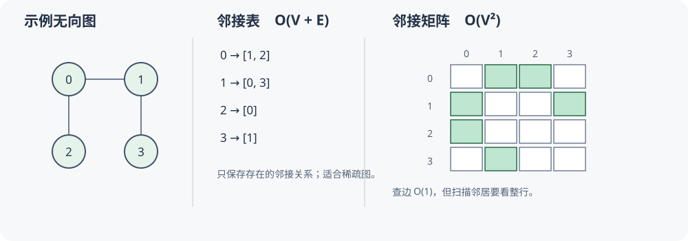

# 图：表示、遍历与路径算法

图由顶点和边组成，用来表示道路、依赖关系、社交连接或状态转换。与线性结构不同，图中的节点可以连接到任意多个其他节点，也可能有环。本项目提供邻接表和邻接矩阵表示，并把遍历与路径算法写成面向 `GraphView` 的通用算法。

::: {.callout-tip}
## 学完本章，你应该能够

- 区分有向/无向图、带权/无权图，以及邻接表和邻接矩阵的空间取舍。
- 手动追踪 DFS、BFS、拓扑排序与 BFS 最短路径。
- 解释 Dijkstra 为什么要求非负权重，以及优先队列如何推进算法。
- 区分无向连通分量和有向强连通分量。
- 根据存储表示推导算法的实际遍历成本。
:::

## 节点 ID 与图的约定

`NodeId` 是 `usize`。节点按加入顺序编号，从 0 开始；仓库 API 不提供删除节点，因此已分配 ID 不会因其他节点删除而改变。`add_edge(from, to)` 在两端 ID 有效时返回 `true`；非法端点返回 `false`。重复边被忽略。无向图把边存入两端的邻接关系，自环只记录一次。

带权图使用非负 `u64` 权重。若同一对节点再次添加边，旧边权保留，不会替换。矩阵中 `None` 表示无边，`Some(0)` 是一条合法的零权边。

```rust
use data_structures::Graph;

let mut graph = Graph::directed();
let a = graph.add_node();
let b = graph.add_node();
let c = graph.add_node();
assert!(graph.add_edge(a, b));
assert!(graph.add_edge(a, c));
assert!(!graph.add_edge(a, 99));
assert_eq!(graph.neighbors(a).unwrap().collect::<Vec<_>>(), [b, c]);
```

## 公共接口地图与节点 ID

| 表示 | 创建/构图 | 查边与邻居 | 适用算法 |
|---|---|---|---|
| `Graph`（邻接表） | `directed()` / `undirected()`、`add_node`、`add_edge` | `has_edge`、`neighbors` | DFS、BFS、拓扑、无权最短路、连通分量 |
| `AdjacencyMatrixGraph` | 同类构造和节点/边操作 | `has_edge`、`neighbors` | 同一组 `GraphView` 算法 |
| `WeightedGraph` | `directed()` / `undirected()`、`add_node`、`add_edge(from,to,weight)` | `edge_weight`、加权 `neighbors` | Dijkstra |
| `WeightedAdjacencyMatrixGraph` | 同类带权构造和节点/边操作 | `edge_weight`、加权 `neighbors` | 同一组 `WeightedGraphView` 算法 |

`add_node()` 返回新的 `NodeId`，图结构只保存这个整数和边。业务名称需由调用方保存，例如 `labels[node_id] = "编译"`。因为图不提供删点，节点编号在构图后稳定；若需从业务数据库导入节点，应维护业务主键与 `NodeId` 的双向映射。非法 ID 在不同 API 中以 `false` 或 `None` 表示，调用者应按各方法签名处理。

## 邻接表与邻接矩阵

邻接表为每个节点保存相邻节点列表。空间为 `O(V+E)`，枚举某节点邻居只需访问其度数。当前实现添加边时会在线性扫描邻居以检查重复，因此单次加边为 `O(degree)`；节点追加摊还 `O(1)`。

邻接矩阵以 `V × V` 表示边，空间为 `O(V²)`；查边为 `O(1)`，加节点需要为各行扩展，时间为 `O(V)`。枚举邻居需要扫描整行 `O(V)`，即使实际邻居很少。矩阵适合图较密或经常判断某对节点是否相邻的场景；邻接表适合稀疏图。

邻接表按边的加入顺序返回邻居；矩阵按升序节点 ID 返回邻居。因此同一个图在两种表示上的遍历顺序可能不同，但路径长度和可达性语义一致。

{#fig-graph-representations width=100%}

带权邻接表与带权矩阵分别将邻居保存为 `(NodeId, u64)` 或矩阵单元格中的权重。四种图实现都实现 `GraphView`；带权图还实现 `WeightedGraphView`。通用算法通过这两个接口请求节点数、方向信息和邻居，不读取具体内部布局。

## 深度优先与广度优先

DFS 用栈沿路径深入，BFS 用队列按层访问。两者都记录 `visited`，避免图中的环造成重复遍历。起点无效时返回 `None`；有效时只返回从起点可达的节点。

```rust
let mut graph = Graph::undirected();
for _ in 0..5 { graph.add_node(); }
graph.add_edge(0, 1);
graph.add_edge(0, 2);
graph.add_edge(1, 3);
graph.add_edge(2, 4);

assert_eq!(graph.breadth_first_search(0), Some(vec![0, 1, 2, 3, 4]));
assert_eq!(graph.depth_first_search(0), Some(vec![0, 1, 3, 2, 4]));
```

邻接表上的遍历为 `O(V+E)`；邻接矩阵要为每个访问节点扫描整行，最坏为 `O(V²)`。算法用 `O(V)` 额外空间保存访问状态、队列/栈和输出。遍历先后由表示返回邻居的顺序决定。

## 无权最短路径

在无权图中，每条边成本相同。BFS 第一次发现一个节点时，已经找到从起点到该节点边数最少的路径。`shortest_path(start, target)` 用前驱数组记录路径，最后从目标回溯到起点并反转结果；起点等于目标时返回只含起点的路径。无效 ID 或目标不可达时返回 `None`。

若存在多条同长度路径，算法按邻居枚举顺序探索，因此返回其中一条确定路径；邻接表与矩阵可能因枚举顺序不同而选择不同路径。邻接表复杂度 `O(V+E)`，矩阵实现最坏 `O(V²)`。

## 拓扑排序

拓扑排序为有向无环图（DAG）寻找线性顺序，使每条边 `u → v` 中 `u` 排在 `v` 前。实现采用 Kahn 算法：先统计每个节点入度，把当前入度为 0 的节点放入队列；每输出一个节点，就“删除”其出边并递减邻居入度；新变成 0 的节点加入队尾。

若最终输出节点数少于 `V`，剩余节点中存在有向环，返回 `None`。无向图也返回 `None`。实现是确定性的：初始零入度节点按 ID 顺序加入；之后新就绪节点的顺序取决于处理节点的邻居顺序。邻接表上为 `O(V+E)`，矩阵上扫描邻居导致 `O(V²)`。

### 应用：构建系统的任务依赖

构建系统需要确保依赖先于依赖者执行。把边定义为“前置任务 → 后续任务”，拓扑排序即可给出一个合法执行顺序；多个合法顺序都可能存在：

```rust
use data_structures::Graph;

let mut deps = Graph::directed();
let nodes: Vec<_> = (0..4).map(|_| deps.add_node()).collect();
let [fetch, compile, test, package] = [nodes[0], nodes[1], nodes[2], nodes[3]];
deps.add_edge(fetch, compile);
deps.add_edge(compile, test);
deps.add_edge(test, package);
deps.add_edge(fetch, package);

let order = deps.topological_sort().unwrap();
let mut position = vec![0; nodes.len()];
for (step, &node) in order.iter().enumerate() {
    position[node] = step;
}
assert!(position[fetch] < position[compile]);
assert!(position[compile] < position[test]);
assert!(position[test] < position[package]);

deps.add_edge(package, fetch); // 循环依赖使 DAG 排序失败
assert!(deps.topological_sort().is_none());
```

如果一个节点代表一个真实任务，生产系统还要在外部维护 `NodeId` 到任务名称、命令和状态的映射；当前图结构只管理整数 ID 和边，不拥有业务对象。每条边表示硬依赖，不能直接表示条件依赖或并行资源限制。

## 带权最短路径：Dijkstra

Dijkstra 适用于边权非负的图。它维护已知最短距离和候选优先队列；每轮取出当前距离最小的候选节点，尝试松弛其出边：若 `distance[u] + weight(u,v)` 更小，就更新 `v` 的距离与前驱并把新候选放入队列。

实现用标准库最大堆包装 `Reverse(distance)` 来获得最小距离优先，并允许同一节点存在多个候选项；取出时若候选距离已不是最新记录，就跳过该过期项。仓库的带权表示将权重限定为非负 `u64`，因此负边无法表达。距离加法使用 checked 运算；溢出的候选被忽略。如果没有可表示的路径到达目标，结果为 `None`。

返回的 `WeightedPath` 包含总距离 `distance` 和从起点到终点（含两端）的节点序列。优先队列上的实现复杂度为 `O((V+E) log V)`，额外空间为 `O(V)`，不含返回路径。

### 应用：非负权道路网络

道路图可把路段耗时或距离作为边权。Dijkstra 返回累计权重最小的路径，而不一定是边数最少的路径：

```rust
use data_structures::WeightedGraph;

let mut roads = WeightedGraph::directed();
let nodes: Vec<_> = (0..4).map(|_| roads.add_node()).collect();
roads.add_edge(nodes[0], nodes[1], 10); // 直达耗时较长
roads.add_edge(nodes[0], nodes[2], 4);
roads.add_edge(nodes[2], nodes[1], 2);
roads.add_edge(nodes[1], nodes[3], 3);
roads.add_edge(nodes[2], nodes[3], 15);

let route = roads.dijkstra(nodes[0], nodes[3]).unwrap();
assert_eq!(route.distance, 9);
assert_eq!(route.nodes, [nodes[0], nodes[2], nodes[1], nodes[3]]);
```

权重可以代表分钟、费用或风险分值，但同一张图中必须使用一致单位；负权边无法由当前 `WeightedGraph` 表达。若业务目标有多个维度，需要定义新的路径代价模型，而不能直接把不同单位的量随意相加。

## 连通分量与强连通分量

无向图的连通分量是节点集合，其中任意两点之间都存在路径。`connected_components(&graph)` 逐个寻找尚未访问的起点，再做 DFS 收集该分量；有向图输入返回 `None`。时间 `O(V+E)`，空间 `O(V)`。

有向图的强连通分量（SCC）要求分量中任意两点互相可达。`strongly_connected_components(&graph)` 使用 Kosaraju 两遍算法：第一遍按 DFS 完成时间排序，构建反向邻接表后按逆完成序遍历。它需要 `O(V+E)` 时间和 `O(V+E)` 额外空间来保存反向图；无向图输入返回 `None`。

## 复杂度速查

| 操作/算法 | 邻接表 | 邻接矩阵 | 额外空间 |
|---|---:|---:|---:|
| 判断边是否存在 | `O(degree)` | `O(1)` | `O(1)` |
| 枚举单个节点邻居 | `O(degree)` | `O(V)` | `O(1)` |
| DFS / BFS / 无权最短路 | `O(V+E)` | `O(V²)` | `O(V)` |
| 拓扑排序 | `O(V+E)` | `O(V²)` | `O(V)` |
| Dijkstra（带权邻接表） | `O((V+E) log V)` | 取决于矩阵行扫描与候选堆 | `O(V)` |
| 连通分量 | `O(V+E)` | `O(V²)` | `O(V)` |
| 强连通分量 | `O(V+E)` | 输入遍历为 `O(V²)` | `O(V+E)` |

加边复杂度另受重复边检查影响：邻接表扫描当前邻居列表，矩阵直接写单元格。`E` 在无向图复杂度中按边数理解；邻接表内部通常为每条非自环边保存两个邻接项。

## 源码导读

- `src/graph/adjacency_list.rs`：有/无向及带权邻接表。重复边和无向自环如何存储？
- `src/graph/adjacency_matrix.rs`：无权矩阵。为什么邻居枚举按节点 ID 排序？
- `src/graph/weighted_adjacency_matrix.rs`：带权矩阵与零权边。`None` 和 `Some(0)` 如何区分？
- `src/graph/traits.rs`：`GraphView`、`WeightedGraphView`。算法需要存储实现暴露哪些操作？
- `src/graph/algorithms.rs`：DFS、BFS、拓扑、路径、分量。访问标记和前驱何时更新？

## 练习

1. 将示例小图分别写成邻接表和邻接矩阵，比较空间占用与枚举节点 0 的成本。
2. 在图中加入一条回边制造有向环。解释 Kahn 算法结束时为什么输出不全。
3. 设计两条边数相同但权重不同的路径，说明 BFS 与 Dijkstra 分别会选择什么。
4. 给 Dijkstra 加入一条权重为 0 的边；再尝试讨论负权边为何会破坏“取出最小候选即可定案”的推理。
5. 画一个包含两个强连通分量的有向图，执行 Kosaraju 两遍过程并写出逆图边。
6. 用 `AdjacencyMatrixGraph` 跑 BFS。为何遍历复杂度不会因为边少而自动降为 `O(V+E)`？

## 本章小结

图表示决定存储成本和邻居枚举成本，通用算法则只依赖图访问接口。DFS/BFS、拓扑排序和无权最短路径解决不同的问题；Dijkstra 通过非负权边和最小候选顺序解决加权最短路；连通分量和强连通分量分别刻画无向连接与有向互达。阅读算法时要同时看节点访问顺序、图表示和适用前提。
