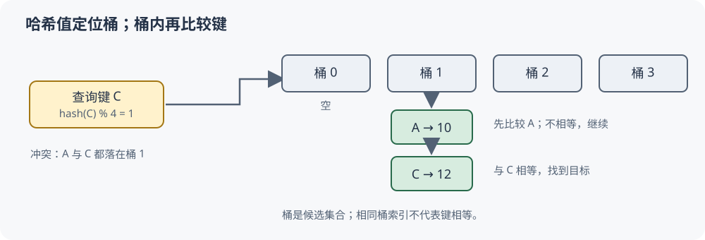

# 哈希表与集合

哈希表通过哈希函数把键映射到桶，再在桶内确认键是否相等。它适合按键查找和更新，不维护键的排序。本项目的 `HashMap<K, V, S>` 使用独立链地址法：每个桶是一个小型 `Vector`，存放落入该桶的键值对；`HashSet<T, S>` 则复用映射实现。

::: {.callout-tip}
## 学完本章，你应该能够

- 区分哈希值、桶索引和键相等比较的职责。
- 手动追踪冲突桶中的查找、替换、删除和扩容。
- 解释负载因子对桶数量与冲突成本的影响。
- 说明 `Hash`、`Eq` 与 `Borrow` 如何支持正确和灵活的键查询。
- 区分期望 `O(1)` 与冲突集中时的最坏 `O(n)`。
:::

## 从映射和集合的用途开始

映射把键关联到值，例如用户名到积分；集合只记录成员是否存在，例如去重或标记已访问元素。

```rust
use data_structures::{HashMap, HashSet};

let mut scores = HashMap::new();
scores.insert("Ada", 10);
scores.insert("Linus", 20);
assert_eq!(scores.get("Ada"), Some(&10));
assert_eq!(scores.remove("Linus"), Some(20));

let mut seen = HashSet::new();
assert!(seen.insert("red"));
assert!(!seen.insert("red"));
assert!(seen.contains("red"));
```

映射再次插入已存在的键时替换值并返回旧值，保留表中原有键；集合插入只在值此前不存在时返回 `true`。两者的迭代顺序都是任意顺序，不应依赖某次运行中观察到的排列。

## 接口地图

| 需求 | HashMap | HashSet |
|---|---|---|
| 创建 | `new()`、`with_capacity(n)` | 同名构造方法 |
| 插入或更新 | `insert(key, value) -> Option<V>` | `insert(value) -> bool` |
| 查询 | `get`、`get_mut`、`get_key_value`、`contains_key` | `get`、`contains` |
| 删除 | `remove`、`remove_entry` | `remove`、`take` |
| 容量信息 | `len`、`capacity`、`bucket_count` | 同样提供 |
| 遍历 | 键值对，任意顺序 | 值，任意顺序 |
| 自定义哈希器 | `with_hasher`、`with_capacity_and_hasher` | 同名构造方法 |

`HashMap::get` 等查询方法支持借用查询：例如以 `String` 为存储键时，可通过兼容的 `str` 借用查询，不必为每次查找创建新的 `String`。存储键与查询形式必须遵守一致的哈希和相等性语义。

### 应用：统计访问路径并筛除重复请求

Web 服务分析日志时，映射可累计每条路径的请求次数；集合可记录已处理的幂等键。二者都以字符串作为拥有的键，但查询时可借用 `&str`：

```rust
use data_structures::{HashMap, HashSet};

let paths = ["/", "/api/items", "/", "/api/items", "/login"];
let mut hits: HashMap<String, usize> = HashMap::with_capacity(8);
for path in paths {
    let next = hits.get(path).copied().unwrap_or(0) + 1;
    hits.insert(path.to_owned(), next);
}
assert_eq!(hits.get("/api/items"), Some(&2)); // 查询不必新建 String

let mut processed = HashSet::new();
assert!(processed.insert(String::from("request-7f2")));
assert!(!processed.insert(String::from("request-7f2")));
assert!(processed.contains("request-7f2"));

let mut report: Vec<_> = hits.iter().map(|(path, &count)| (path.as_str(), count)).collect();
report.sort_unstable_by(|left, right| left.0.cmp(right.0));
assert_eq!(report, [("/", 2), ("/api/items", 2), ("/login", 1)]);
```

累计时使用 `get` 后 `insert`，明确表达“读取旧计数、写回新计数”。哈希迭代顺序不稳定，因此报告排序后再输出；只有在展示或序列化时需要稳定顺序，不必为了每次查询先排序整张表。真实幂等处理还要把“检查并登记”与业务副作用放在同一事务边界内，单独的 `HashSet` 不能提供并发事务保证。

## 从键到桶

设桶数量为 `m`，键为 `k`。哈希构建器产生哈希值 `h(k)`，实现以 `h(k) % m` 得到桶索引。哈希只负责缩小候选范围，不证明两个键相等；桶内仍需用 `Eq` 比较。

即使两个不同键得到相同桶索引，也只是发生冲突，不代表键相同。反过来，若 `a == b`，它们必须产生相同哈希值，否则同一键可能落入不同桶，查找和去重就会失效。

{#fig-hash-buckets width=100%}

## 插入、查找与删除

### 插入或更新

`insert(key, value)` 先算桶索引并扫描该桶：

1. 若找到相等键，用新值替换旧值，返回 `Some(old_value)`，长度不变。
2. 若桶中没有该键，计算插入后的长度。
3. 若新长度超过当前容量阈值，扩容并重排旧条目。
4. 按新桶数量重新计算桶索引，再加入新键值对，长度加一，返回 `None`。

重新计算桶索引很关键：扩容改变桶数量，旧索引不能直接沿用。

### 查询

查询先用同一个哈希器和桶数定位单个桶，再在桶内以键相等比较查找。若负载受控且哈希分布良好，平均只需检查很少的条目；如果所有键都落在同一个桶，查找就要扫描最多 `n` 个条目。

### 删除

删除先扫描目标桶找到条目位置，再从该桶向量中移除键值对并减少总长度。`remove` 只返回值；`remove_entry` 返回键和值。删除后桶数量不缩小，因此不会因删除而立即重新分配整张表。

## 冲突与扩容

本实现把冲突条目放在桶内的小向量中，而非开放寻址。设元素数为 `n`、桶数为 `m`，负载因子为 `α = n / m`。表维持约 `0.75` 的上限：8 个桶时可容纳 6 个条目；插入第 7 个新条目前会把桶数量翻倍至 16。碰撞仍可能使某个桶超过平均长度。

扩容时实现先遍历现有条目，统计每个新桶将收到多少条目，并为各新桶预留空间；分配完成后，再移动条目到新桶。新索引使用新桶数量计算，扩容后总长度和键值对应关系不变。重排需要处理当前全部条目，成本为 `O(n)`；几何增长使插入的摊还成本保持期望 `O(1)`，前提仍是哈希分布不严重偏斜。

注意 `capacity()` 是达到下一次增长前可容纳的条目数，不是桶数量；`bucket_count()` 才返回桶数。

## 键的约束与哈希构建器

键需实现 `Hash + Eq`。两者必须一致：相等的键必须哈希相同。若键在进入映射后发生影响 `Hash` 或 `Eq` 结果的内部变化，表无法保证之后还能在正确桶中找到它。适合作键的字段通常应在存储期间保持哈希语义稳定。

类型参数 `S: BuildHasher` 负责构造哈希器，默认使用随机化 `RandomState`。定制构建器可服务专门用途，但较弱的哈希策略可能令恶意输入更容易集中冲突。构建器在映射存续期间固定；替换它需要重新计算并移动所有条目。

## HashSet 如何复用 HashMap

`HashSet<T, S>` 内部用 `HashMap<T, (), S>` 保存成员。插入、查询、冲突处理、桶增长和删除都委托给映射；集合层只调整返回值语义。除 `insert/contains/remove/take` 外，还提供 `is_disjoint` 和 `is_subset`，这些关系操作通过逐项查找完成，成本约为集合大小乘以成员查询成本。

这种组合让集合与映射共享一致的哈希规则，也避免维护两套桶结构。如果需要集合并集等更广操作，应明确其迭代顺序和哈希器约束，而不是假设集合是排好序的。

## 复杂度速查

设 `n` 为条目数，`b` 为被扫描桶中的条目数：

| 操作 | 平均/期望 | 最坏 | 说明 |
|---|---:|---:|---|
| `get`、`contains_key` | `O(1)` | `O(n)` | 哈希定位后扫描桶 |
| 插入新键 | 摊还 `O(1)` | `O(n)` | 扩容重排或冲突集中 |
| 替换已有键 | `O(1 + b)` | `O(n)` | 桶内比较，不增加长度 |
| 删除 | `O(1 + b)` | `O(n)` | 桶内查找及移除 |
| 遍历 | `O(m + n)` | `O(m + n)` | 当前迭代器逐桶检查条目 |
| 集合子集/不相交判断 | 期望约 `O(n)` | `O(n·q)` | `q` 为另一集合查询成本 |

这些界限假设哈希器计算成本为常数；长字符串的哈希本身还取决于键长度。最坏冲突时，哈希表不会保持常数级查找。

## 源码导读

- `src/hash/map.rs`：桶布局、查找、插入、删除和扩容。扩容前为何先统计各桶条目数？
- `src/hash/map/iter.rs`：按桶遍历。为什么顺序不稳定，遍历要检查桶？
- `src/hash/map/traits.rs`：集合构造与格式化 trait。`FromIterator` 如何复用 `insert`？
- `src/hash/set.rs`：用映射组合集合语义。为什么 `insert` 返回 bool？
- `src/hash/set/iter.rs`：迭代器包装。如何隐藏映射中的单元值 `()`？

## 练习

1. 假设桶数为 8，键 A、B、C 的桶索引依次为 3、3、6。画出桶布局，并追踪查找 B 时做了几次相等比较。
2. 对同一个键连续插入值 10 和 12。列出两次返回值、映射长度和最终值。
3. 表有 8 个桶、6 个条目时插入一个新键。说明扩容前后桶数、容量阈值和条目位置如何改变。
4. 若所有键都映射到桶 0，查找最坏需要检查多少条目？此时“期望 `O(1)`”的假设哪里不成立？
5. 设计一对 `String`/`str` 借用查询示例，说明 `Borrow` 带来的好处及哈希一致性要求。

## 本章小结

哈希表先用哈希值定位桶，再用相等性确认键。独立链地址让冲突条目留在同一桶中；负载阈值触发扩容和重排。均匀分布下查找和插入期望快速，冲突集中时仍可能线性扫描。`HashSet` 复用 `HashMap<T, ()>`，把结构机制与集合语义分开。
