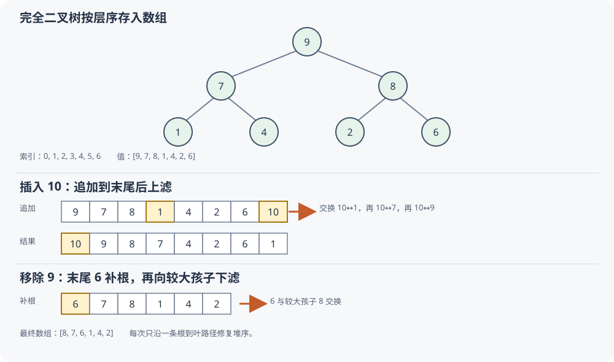

# 堆与优先队列

堆把“谁应该先处理”编码成局部顺序约束。它不要求整个序列排序，只保证根节点是最大值或最小值，因此能以较低成本反复取出当前优先级最高的元素。本项目实现最大二叉堆、d 叉堆、带显式优先级的队列，以及可按索引更新优先级的队列。

::: {.callout-tip}
## 学完本章，你应该能够

- 根据父子关系验证最大堆序，并通过数组索引画出堆形状。
- 追踪插入的上滤和删除根节点的下滤。
- 解释为什么堆迭代顺序不是排序顺序，以及批量建堆可在线性时间完成。
- 比较二叉堆与 d 叉堆的高度和每层比较成本。
- 说明索引优先队列为何必须同步维护堆数组与反向位置表。
:::

## 堆序与数组布局

本项目的 `BinaryHeap<T>` 和 `DaryHeap<T, D>` 都是最大堆：每个父节点不小于任一孩子，最大元素位于根。完全二叉树按层序紧凑地放进 `Vector`，不需要节点指针。二叉堆中索引 `i` 的孩子是 `2i+1`、`2i+2`，父节点是 `(i-1)/2`（根没有父节点）。

```rust
use data_structures::BinaryHeap;

let mut heap = BinaryHeap::new();
for value in [4, 9, 2, 7, 1] {
    heap.push(value);
}
assert_eq!(heap.peek(), Some(&9));
assert_eq!(heap.pop(), Some(9));
```

堆序只约束父子，不约束同层节点之间的大小，也不保证数组从小到大或从大到小。因此 `iter()` 按内部堆布局遍历；要得到排序结果，应反复 `pop`，代价为 `O(n log n)`。

{#fig-heap-operations width=100%}

## 插入：上滤

插入先把新值追加到数组末端，保持完全树形状。若它大于父节点，就交换并继续向根方向检查；直到父节点更大或到达根，堆序恢复。每次交换沿树高移动一步，时间为 `O(log n)`。

例：在根为 9 的堆中加入 8。8 先进入末尾，再与父节点 4 交换；新的父节点 9 已不小于 8，操作结束。只有从新增位置到根的路径可能违反堆序，其他子树不用检查。

## 移除最大值：末尾补根并下滤

`pop()` 取走末尾值。如果堆非空，就把末尾值放到根，再反复与较大的孩子比较：若较大孩子超过当前节点，则交换并继续向下；若当前节点已经不小于孩子，则完成。最多经过树高，时间为 `O(log n)`。`peek()` 只读根，为 `O(1)`。

一次下滤必须选两个孩子中较大的那个。如果换成较小孩子，另一个更大的孩子仍会大于新父节点，违反最大堆序。只有根到叶的路径需要检查。

## 批量建堆

逐个插入 `n` 个值需要 `O(n log n)`。`from_vec` 和 `FromIterator` 先把值放入数组，再从最后一个有孩子的节点向根依次下滤，时间为 `O(n)`。靠近叶子的节点数量多但下滤距离短；靠近根的节点少但最多下滤树高，所有节点的下滤工作总和是线性级别。

## d 叉堆：高度与比较次数的权衡

`DaryHeap<T, const D: usize = 4>` 把每个节点最多扩展到 `D` 个孩子。`D` 必须至少为 2。数组中索引 `i` 的第一个孩子为 `D*i+1`，孩子最多占据 `D*i+1 .. D*i+D+1`；父节点为 `(i-1)/D`。

分支数增大后树高约为 `log_D(n)`，上滤层数减少；下滤每层要扫描最多 `D` 个孩子，比较次数约为 `D log_D(n)`。因此 `D` 越大不代表所有操作都更快，真实表现还受比较成本和数据规模影响。当前默认分支数为 4，使用者可显式选其他编译期常数。

## 优先队列：把优先级与值分开

`PriorityQueue<P, T>` 用堆按优先级排序，`T` 本身无需实现 `Ord`。较大的 `P` 先出队；相同优先级元素的先后顺序未指定。

```rust
use data_structures::PriorityQueue;

let mut jobs = PriorityQueue::new();
jobs.push(2, "background");
jobs.push(9, "urgent");
assert_eq!(jobs.peek(), Some((&9, &"urgent")));
assert_eq!(jobs.pop(), Some((9, "urgent")));
```

入队和出队为 `O(log n)`，查看最高优先级为 `O(1)`。如果应用中的“更重要”对应更小的数值，可反转优先级比较或包装优先级类型；当前类型语义明确为数值越大优先级越高。

### 应用：告警分诊与同级稳定顺序

值班系统通常先处理严重程度更高的告警；同级告警若希望先到先处理，应把递增序号纳入优先级，而不能依赖堆内部顺序：

```rust
use data_structures::PriorityQueue;
use std::cmp::Reverse;

let mut triage = PriorityQueue::new();
triage.push((5, Reverse(1)), "数据库不可用");
triage.push((3, Reverse(2)), "磁盘空间偏低");
triage.push((5, Reverse(3)), "支付超时增加");

assert_eq!(triage.pop(), Some(((5, Reverse(1)), "数据库不可用")));
assert_eq!(triage.pop(), Some(((5, Reverse(3)), "支付超时增加")));
```

元组按字典序比较：严重度较高者先出；同严重度时 `Reverse(sequence)` 令较早序号拥有较高堆优先级。序号必须在系统运行期间保持唯一，或再加入其他稳定标识符作为最终比较项。

### 应用：持续维护最慢的 K 个请求

监控系统不一定要保存所有延迟。用最小堆保留当前最大的 `K` 个值：堆满后若新延迟高于堆顶，就移除当前 top-K 中最小的一项。

```rust
use data_structures::BinaryHeap;
use std::cmp::Reverse;

let mut slowest = BinaryHeap::new(); // Reverse 让堆顶成为保留集合中的最小值
for latency_ms in [12, 80, 31, 240, 95, 17, 180] {
    slowest.push(Reverse(latency_ms));
    if slowest.len() > 3 {
        slowest.pop();
    }
}
let mut top: Vec<_> = std::iter::from_fn(|| slowest.pop())
    .map(|Reverse(latency)| latency)
    .collect();
top.reverse();
assert_eq!(top, [95, 180, 240]);
```

处理 `n` 个样本、只保留 `K` 个值，时间为 `O(n log K)`，额外空间为 `O(K)`。这里用堆反复 `pop` 取得保留集合的有序结果；若直接调用 `iter()`，得到的只是堆布局。

## 索引优先队列：通过索引更新

`IndexPriorityQueue<P>` 用固定索引范围 `0..capacity` 标识条目。内部有三组状态：

- `heap[position] = index`：堆中每个位置放哪个外部索引。
- `priorities[index] = Some(priority)`：该索引当前的优先级。
- `positions[index] = Some(position)`：反向查找索引当前位于堆的哪里。

不变量是：若索引在队列中，`heap[positions[index]] == index`，且 `priorities[index]` 存在；堆中每个索引只出现一次。交换两个堆位置时，必须同时更新两个索引对应的 `positions`。

`set(index, priority)` 插入新索引或替换已有优先级，返回旧优先级；更新后根据新值相对父节点的关系选择上滤或下滤。越过固定索引范围时返回 `Err(priority)`，将被拒绝的优先级交回调用者。`get`、`contains` 和 `peek` 为 `O(1)`；`set`、按索引 `remove` 与 `pop` 为 `O(log n)`。空间为 `O(capacity)`，因为优先级和反向位置表预先为整个索引域分配槽位。

```rust
use data_structures::IndexPriorityQueue;

let mut queue = IndexPriorityQueue::new(4);
queue.set(2, 10).unwrap();
queue.set(1, 7).unwrap();
queue.set(1, 12).unwrap(); // 更新索引 1 的优先级
assert_eq!(queue.pop(), Some((1, 12)));
assert_eq!(queue.pop(), Some((2, 10)));
```

这类队列适合外部实体 ID 固定且优先级会变化的任务，例如调度器中每个 worker 的下一次唤醒时间。`set(worker_id, time)` 可插入或更新一个 worker 的时刻；`pop()` 返回最近时刻对应的索引和值。索引域必须在构造时确定，ID 超范围时原优先级会随 `Err` 返回。

## 公共接口地图

| 结构 | 查看 | 加入/更新 | 移除 | 迭代含义 |
|---|---|---|---|---|
| `BinaryHeap<T>` | `peek()`、`len()`、`capacity()` | `push(T)`、`from_vec(Vec<T>)` | `pop()` 最大值 | `iter()` 为内部堆布局 |
| `DaryHeap<T, D>` | `peek()`、`len()`、`capacity()` | `push(T)`、`from_vec(Vec<T>)` | `pop()` 最大值 | 内部堆布局 |
| `PriorityQueue<P, T>` | `peek() -> (&P, &T)` | `push(priority, value)` | `pop() -> (P, T)` | 内部堆布局，不保证稳定同级顺序 |
| `IndexPriorityQueue<P>` | `get(index)`、`contains`、`peek` | `set(index, priority)` | `remove(index)`、`pop()` | 未提供迭代器 |

前三种结构管理可变长度元素；索引优先队列则按最大索引容量预先建表。若需要更新任意已有项的优先级，只有索引队列提供直接索引更新，普通优先队列需要插入新候选并在弹出时验证旧候选是否仍有效。

## 复杂度速查

令 `n` 为当前堆元素数，`D` 为 d 叉堆分支数：

| 操作 | 二叉堆/优先队列 | DaryHeap | IndexPriorityQueue |
|---|---:|---:|---:|
| 查看最大值/优先级 | `O(1)` | `O(1)` | `O(1)` |
| 插入新项 | `O(log n)` | `O(log_D n)` 上滤 | `O(log n)` |
| 更新已有优先级 | 无按项更新 API | 无按项更新 API | `O(log n)`，`set(index, priority)` |
| 删除最大项 | `O(log n)` | `O(D log_D n)` | `O(log n)` |
| 批量建堆 | `O(n)` | `O(n)`（固定 D） | — |
| 遍历 | `O(n)`，内部布局 | `O(n)`，内部布局 | 未提供迭代器 |

动态堆的底层 `Vector` 扩容会偶尔搬移元素；对重复插入序列，容量增长的成本摊还在操作中。索引优先队列的内存按最大索引容量分配，而非当前元素数。

## 源码导读

- `src/heap/binary_heap.rs`：完全二叉数组、上滤、下滤和建堆。下滤为什么选较大的孩子？
- `src/heap/dary_heap.rs`：可配置分支数的孩子索引和筛动。分支数如何改变高度与每层比较？
- `src/heap/priority_queue.rs`：优先级包装与堆委托。为什么值类型不必实现 `Ord`？
- `src/heap/index_priority_queue.rs`：索引堆、优先级表和反向位置表。每次交换维护哪些数组？

## 练习

1. 将 `[4, 9, 2, 7, 1]` 画成最大堆，写出数组层序；插入 8 并逐步记录上滤。
2. 对上述堆执行 `pop`，标记末尾值放到根后每一次下滤交换。
3. 解释只满足“每个父节点大于一个孩子”为什么不足以构成最大堆。
4. 比较二叉堆和四叉堆中 `n=64` 时的大致高度，并列出下滤每层最多需比较几个孩子。
5. 在索引优先队列中改变一个非根索引的优先级，分别考虑优先级上升和下降；说明位置表如何随交换变化。
6. 若优先级相等，为什么不能假设先插入的任务先弹出？若应用需要稳定顺序，应给比较键增加什么信息？

## 本章小结

堆只维护父子优先关系，因而根端访问快速，但完整迭代不排序。上滤和下滤只修复一条树高路径；批量建堆可在线性时间完成。优先队列把业务值与优先级分开，索引优先队列则额外维护位置反查，让优先级更新保持对数成本。
