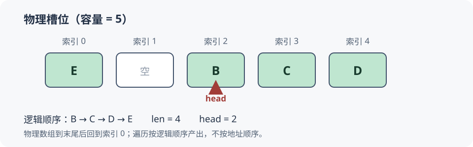

# 线性容器：栈、队列与双端队列

线性容器保存一个有先后次序的序列。它们的区别是允许从哪些端点读写：栈限制为同一端，队列分开加入端和移除端，双端队列则开放两端。限制接口让调用者表达数据流规则，也让实现可以复用动态数组或环形缓冲区。

本章先介绍共同背景，再分别深入 `Stack<T>`、`Queue<T>`、`Deque<T>` 与 `FixedCapacityQueue<T>`。每个结构都从用途、底层表示、操作算法、完整公共 API、错误与边界语义、应用例子和复杂度展开。

::: {.callout-tip}
## 学完本章，你应该能够

- 用 LIFO、FIFO 描述栈与队列，并判断哪种容器符合给定处理顺序。
- 从 `head`、`len` 和容量推导环形缓冲区的逻辑与物理位置。
- 逐步追踪栈、队列和双端队列的插入、移除及扩容。
- 区分借用、可变借用和消费迭代器的行为与方向。
- 根据满载策略和内存限制，在动态队列与固定容量队列间选择。
:::

## 四种抽象先放在一起看

栈遵循后进先出（LIFO）：最近压入的元素先取出。队列遵循先进先出（FIFO）：最早入队的元素先取出。双端队列允许从任一端加入或移除。固定容量队列仍是 FIFO，但容量不会增长，满时把新值交还调用者。

| 抽象 | 加入 | 移除 | 典型用途 |
|---|---|---|---|
| Stack | 栈顶 | 栈顶 | 语法分析、撤销历史、DFS |
| Queue | 后端 | 前端 | 任务排队、BFS、缓冲 |
| Deque | 前端或后端 | 前端或后端 | 滑动窗口、两端消费 |
| FixedCapacityQueue | 后端 | 前端 | 固定内存缓冲、背压边界 |

```rust
use data_structures::{Deque, Queue, Stack};

let mut stack = Stack::new();
stack.push("first");
stack.push("last");
assert_eq!(stack.pop(), Some("last"));

let mut queue = Queue::new();
queue.enqueue("first");
queue.enqueue("second");
assert_eq!(queue.dequeue(), Some("first"));

let mut deque = Deque::new();
deque.push_front(1);
deque.push_back(2);
assert_eq!(deque.pop_back(), Some(2));
```

栈的迭代方向为栈顶到栈底；队列和双端队列的共享迭代方向为逻辑前端到后端。这些顺序由容器语义决定，不表示内存地址方向。

## 共同的存储背景：Vector 与 RingBuffer

### Stack 组合 Vector

`Stack<T>` 内部持有项目自己的 `Vector<T>`，并把向量尾部定义为栈顶。向量已经负责连续存储、容量增长、元素移动和析构；栈只提供 LIFO 操作，不再实现第二套存储代码。

### RingBuffer 是什么

环形缓冲区（ring buffer，也称 circular buffer）用一段连续槽位模拟首尾相接的存储区。读写游标走到最后一个槽位后绕回索引 0。它保留数组的紧凑布局与较好的缓存局部性，同时避免普通数组队列每次移除头元素时把后续元素整体左移。

本项目的 `RingBuffer<T>` 是 `foundation` 中的私有实现，不作为 crate 的独立公共类型导出。动态 `Queue<T>`、`Deque<T>` 和 `FixedCapacityQueue<T>` 组合它，并在公开 API 上表达各自不同的顺序与容量策略。

环形缓冲区可以用于很多 FIFO 以外的场景：设备或网络数据的暂存区、音视频流处理、循环日志、定长历史窗口、事件循环和生产者/消费者之间的缓冲边界。固定容量缓冲区可限制内存使用并避免运行期间扩容；动态环形缓冲区在达到容量后可扩展。这个底层存储本身不提供并发同步；多线程生产者/消费者还需要锁、原子游标和内存顺序等并发协议，不能把普通 `&mut` 容器直接当作无锁队列。

### 表示方式与核心状态

项目缓冲区用 `Vector<Option<T>>` 保存槽位：`Some(value)` 表示该槽拥有一个已初始化的 `T`，`None` 表示空槽。这样不要求 `T: Default`，也让实现只从活动槽位移交或析构元素。缓冲区另保存：

- `head`：逻辑首元素所在的物理索引；
- `len`：当前元素数；
- `capacity`：槽位数，在实现中等于 `slots.len()`。

逻辑偏移 `i`（`0 <= i < len`）对应的物理位置为 `(head + i) mod capacity`。代码采用分支式环绕计算，避免直接把 `head + i` 相加时可能溢出。后端写入使用偏移 `len` 的槽位；后端读取/移除使用偏移 `len - 1`。

{#fig-ring-buffer width=92%}

主要状态不变量如下：

1. `0 <= len <= capacity`。
2. 从 `head` 开始的 `len` 个逻辑槽位都为 `Some(T)`。
3. 逻辑范围以外的槽位为 `None`，不会被借用或析构为元素。
4. 空状态没有可访问端点；空缓冲区加入第一个元素后，首尾都指向该值。

容量为零时不能计算槽位索引。动态缓冲区在第一次加入前先增长；固定容量为零时保持空状态并拒绝所有加入。

### RingBuffer 的创建、增删改查与遍历

`RingBuffer` 本身是私有类型，但它的底层操作可通过包装容器的 API 学习。下表列出内部原语及对应的公开入口：

| 操作 | RingBuffer 内部行为 | 公开包装入口 |
|---|---|---|
| 创建空结构 | `new()`：无元素槽分配，`head = len = 0` | 各容器 `new()` |
| 预分配 | `try_with_capacity(c)`：分配 `c` 个空槽并初始化为 `None` | 队列/双端队列/固定队列的 `with_capacity` 与 `try_with_capacity` |
| 尾部新增 | `try_push_back(value)`：写逻辑尾槽；必要时先增长 | `Queue::enqueue`、`Deque::push_back` |
| 头部新增 | `try_push_front(value)`：头索引向前绕一格后写值；必要时先增长 | `Deque::push_front` |
| 固定容量尾部新增 | `try_push_back_fixed(value)`：不扩容，满时原样返回值 | `try_enqueue` |
| 读取端点 | `front()`、`back()`：按首/尾物理位置借用 | 队列和双端队列的 `front`、`back` |
| 修改端点 | `front_mut()`、`back_mut()`：可变借用，不改变队列结构 | `front_mut`；双端队列另有 `back_mut` |
| 头部删除 | `pop_front()`：取走 `head` 值，前进头索引 | `dequeue`、`pop_front` |
| 尾部删除 | `pop_back()`：取走逻辑尾槽，不移动其他值 | `Deque::pop_back` |
| 清空 | 重复头部取值并销毁，保留槽位分配 | 队列、双端队列的 `clear` |
| 遍历 | `iter()`、`iter_mut()` 按逻辑顺序跨环遍历 | 包装容器的同名方法 |

该缓冲区没有任意索引的 `get(i)` / `set(i, value)`，也没有任意位置插入、删除。要修改所有活动元素，可使用 `iter_mut()`；只修改首尾可用端点可变引用。它的职责是高效管理环形端点，而不是替代 `Vector` 成为通用随机访问序列。

### 一次环绕操作的逐步状态

容量为 5，先加入 A、B、C，再从前端移除 A，槽位状态为 `[_, B, C, _, _]`，`head = 1`、`len = 2`。继续加入 D、E 后为 `[_, B, C, D, E]`，`head = 1`、`len = 4`。再移除 B、C 后，`head = 3`、`len = 2`，逻辑内容是 `[D, E]`；加入 F、G 时尾部从槽位 4 绕回 0、1，物理状态变成 `[F, G, _, D, E]`，但逻辑顺序仍为 `[D, E, F, G]`。

环绕只改变逻辑到物理槽位的映射，不改变顺序。删除不需要移动 D、E，前端和后端都能保持常数时间。

### 容量与扩容规则

`RingBuffer::new()` 从容量 0 开始。动态缓冲区在 `len == capacity` 时扩展：第一次扩为 4 个槽，之后每次翻倍（4、8、16……）。构造时调用 `with_capacity(c)` 会预先建立 `c` 个空槽；之后只有装满才继续按翻倍策略扩容。`capacity()` 返回当前槽数，不是当前元素数，也不承诺未来的具体增长序列是稳定 API。

扩容会申请并初始化新数组，再按逻辑顺序把现有元素移动到新数组索引 `0..len`，最后将 `head` 归零。若分配或容量计算失败，移动还未开始，原缓冲区仍保留完整内容。动态包装容器的普通加入方法会在错误时 panic；`try_` 方法把未加入值和 `TryReserveError` 返回。固定容量队列不走扩容路径，满时只返回未入队值。

初始化 `c` 个空槽需 `O(c)` 时间和空间。满载扩容要初始化新槽并移动 `n` 个活动值，成本为 `O(new_capacity)`，在翻倍策略下也可记为该次 `O(n)` 级别；加入操作摊还 `O(1)`。`clear` 保留槽位和容量，因此清空后再次加入可以复用已分配空间。

### RingBuffer 复杂度速查

令 `n = len`，`c = capacity`：

| 内部操作 | 不扩容时 | 最坏单次 | 说明 |
|---|---:|---:|---|
| 创建空结构 | `O(1)` | `O(1)` | 不分配槽位 |
| 创建指定容量 | `O(c)` | `O(c)` | 分配并逐槽写入 `None` |
| `len` / `capacity` / 空状态 | `O(1)` | `O(1)` | 读取字段或槽位向量长度 |
| 前后端读取/修改 | `O(1)` | `O(1)` | 计算一个槽位索引 |
| 前后端插入 | `O(1)` | `O(n)` 级别 | 满载时需增长和搬移 |
| 前后端删除 | `O(1)` | `O(1)` | 取走一个 `Option<T>` 并更新头/长 |
| `clear` | `O(n)` | `O(n)` | 逐个析构，保留容量 |
| 遍历 | `O(n)` | `O(n)` | 按逻辑顺序访问活动值 |
| 空间 | — | `O(c)` | 包含空槽位 |

固定容量缓冲区在构造后加入的 worst-case 也是 `O(1)`；动态缓冲区插入表中的最坏值来自扩容，但一串尾部或双端插入在几何增长下摊还为 `O(1)`。

## 栈 Stack：最近加入的先出来

### 底层操作原理

栈顶永远是 `Vector` 的最后一个元素：

- `push(value)` 委托给向量尾部追加。
- `pop()` 委托给向量尾部移除。
- `peek()` / `peek_mut()` 访问向量最后一个元素，但不移交它。
- `iter()` 反转向量切片迭代器，因此从栈顶向栈底读取。

尾部追加摊还 `O(1)`，容量增长时单次 `O(n)`；尾部移除和查看为 `O(1)`。栈没有公开 `capacity()` 方法，尽管构造时可以请求预留容量。

### Stack 的完整公共 API

| 分组 | API | 语义与边界 |
|---|---|---|
| 创建 | `new()` | 创建空栈 |
| 预留空间 | `with_capacity(n)` | 请求至少 `n` 个元素的空间；分配失败时 panic |
| 可恢复创建 | `try_with_capacity(n)` | 返回 `Result<Stack, TryReserveError>` |
| 状态 | `len()`、`is_empty()` | 返回元素数或空状态 |
| 加入 | `push(value)` | 将值放到栈顶；分配失败时 panic |
| 可恢复加入 | `try_push(value)` | 失败时错误保留值，可用 `into_value()` 取回 |
| 移除 | `pop()` | 弹出栈顶；空栈返回 `None` |
| 查看 | `peek()`、`peek_mut()` | 返回顶部共享/可变引用；空栈返回 `None` |
| 清空 | `clear()` | 销毁所有元素 |
| 遍历 | `iter()`、`iter_mut()` | 从栈顶向栈底借用遍历 |

`Stack<T>` 还实现 `Default`、`Extend<T>`、`FromIterator<T>`。对 `&Stack`、`&mut Stack` 和消费掉的 `Stack` 使用 `for` 循环时，元素都按栈顶到栈底产出。`Extend` 会按输入顺序压入，因此最后输入的值会成为新的栈顶。

### 应用：检查括号是否匹配

每遇到左括号就压栈；遇到右括号时，弹出最近尚未匹配的左括号并核对种类。若右括号前没有左括号，或种类不匹配，立即失败；扫描结束后栈必须为空。

```rust
use data_structures::Stack;

fn delimiters_balanced(input: &str) -> bool {
    let mut opens = Stack::new();
    for ch in input.chars() {
        match ch {
            '(' | '[' | '{' => opens.push(ch),
            ')' | ']' | '}' => {
                let Some(open) = opens.pop() else { return false };
                let matches = matches!((open, ch), ('(', ')') | ('[', ']') | ('{', '}'));
                if !matches { return false; }
            }
            _ => {}
        }
    }
    opens.is_empty()
}

assert!(delimiters_balanced("a[(b + c) * {d}]"));
assert!(!delimiters_balanced("([)]"));
```

若输入长度为 `n`，每个括号最多入栈和出栈一次，时间 `O(n)`，最坏额外空间 `O(n)`。嵌套结构需要“最后打开的先关闭”，这正是 LIFO 约束。

## 环形缓冲区算法：端点操作为什么不用搬移

### Queue 的尾部入队与头部出队

入队计算逻辑偏移 `len` 对应的物理槽位，把 `None` 替换为 `Some(value)`，然后 `len += 1`。出队从 `head` 槽取出值，把槽位置为 `None`，然后减少长度并把 `head` 前进一格（末端之后绕回 0）。其他元素不动。

例如容量为 5，执行 `enqueue(A), enqueue(B), enqueue(C), dequeue(), enqueue(D), enqueue(E)`：

| 状态 | 逻辑顺序 | head | 物理槽位 `[0,1,2,3,4]` |
|---|---|---:|---|
| 入队 A、B、C | A, B, C | 0 | `[A,B,C,_,_]` |
| 出队 A | B, C | 1 | `[_,B,C,_,_]` |
| 入队 D、E | B, C, D, E | 1 | `[_,B,C,D,E]` |

若再从前端移除 B、C，并从后端加入 F、G，物理尾部耗尽后会绕回槽位 0；逻辑队列仍连续。队列不需要把 C、D、E 左移填满数组开头。

### 动态扩容与失败安全

共享缓冲区首次增长到 4 个槽位，之后容量翻倍。扩容按以下顺序进行：

1. 先计算新容量并分配、初始化新槽位。
2. 分配成功后，按旧缓冲区的逻辑顺序逐个取出值。
3. 将值按顺序写到新缓冲区 `0..len`。
4. 换用新槽位数组，并将 `head` 归零。
5. 再执行本次入队或双端插入。

因为新分配先于移动已有元素，分配失败时旧缓冲区仍然完整。`try_enqueue`、`try_push_front` 和 `try_push_back` 返回含原值与 `TryReserveError` 的错误；对应普通方法在失败时 panic。扩容搬移 `n` 个值，单次 `O(n)`；几何增长令动态追加的摊还成本为 `O(1)`。

## 队列 Queue：先进先出

### 底层操作与语义

`Queue<T>` 保存 FIFO 序列，底层是动态 `RingBuffer<T>`。尾部入队、头部出队都只更新一个槽位、`head` 或 `len`，不移动其余元素。查看 `front` / `back` 只借用端点，不改变顺序。

### Queue 的完整公共 API

| 分组 | API | 语义与边界 |
|---|---|---|
| 创建 | `new()` | 空队列，不申请元素槽位 |
| 预留空间 | `with_capacity(n)` | 创建时预留；分配失败时 panic |
| 可恢复创建 | `try_with_capacity(n)` | 分配失败返回 `TryReserveError` |
| 状态 | `len()`、`is_empty()`、`capacity()` | 长度、空状态、扩容前可容纳数 |
| 入队 | `enqueue(value)` | 放到后端；增长失败时 panic |
| 可恢复入队 | `try_enqueue(value)` | 返回 `TryEnqueueError<T>`；队列不变且值可取回 |
| 出队 | `dequeue()` | 移交前端值；空队列返回 `None` |
| 查看前端 | `front()`、`front_mut()` | 共享/可变借用；空队列返回 `None` |
| 查看后端 | `back()` | 共享借用；空队列返回 `None` |
| 清空 | `clear()` | 销毁队列元素，保留槽位缓冲 |
| 遍历 | `iter()`、`iter_mut()` | 从前端到后端借用遍历 |

队列实现 `Default`、`Extend<T>`、`FromIterator<T>`，也支持对 `&Queue` 和消费掉的 `Queue` 使用 `IntoIterator`。借用迭代产出 `&T`；消费迭代按 FIFO 顺序移交 `T`。它没有实现 `IntoIterator for &mut Queue`，需要可变遍历时显式调用 `iter_mut()`。

`TryEnqueueError<T>` 可用 `error()` 查看分配错误、`into_value()` 取回未入队值，或用 `into_parts()` 同时取回值与错误。普通 `enqueue` 适合分配失败属于不可恢复程序错误的场景；库代码或需要保留任务值的应用应优先考虑 fallible 版本。

### 应用：广度优先搜索

BFS 使用队列保存“已发现但尚未展开”的节点。节点第一次入队时就标记访问，确保每个节点至多入队一次；每次出队后再把未访问邻居按顺序加入。

```rust
use data_structures::Queue;

fn bfs_order(adjacency: &[Vec<usize>], start: usize) -> Vec<usize> {
    let mut visited = vec![false; adjacency.len()];
    let mut order = Vec::new();
    let mut queue = Queue::new();
    visited[start] = true;
    queue.enqueue(start);

    while let Some(node) = queue.dequeue() {
        order.push(node);
        for &neighbor in &adjacency[node] {
            if !visited[neighbor] {
                visited[neighbor] = true;
                queue.enqueue(neighbor);
            }
        }
    }
    order
}

let graph = [vec![1, 2], vec![0, 3], vec![0, 3], vec![1, 2]];
assert_eq!(bfs_order(&graph, 0), [0, 1, 2, 3]);
```

邻接表图上的 BFS 时间为 `O(V+E)`，队列与访问标记最坏占 `O(V)`。FIFO 确保按离起点的边数一层层扩展，因此第一次发现目标时路径边数最少。

## 双端队列 Deque：两端都可作为工作端

### 底层操作与语义

`Deque<T>` 也使用动态 `RingBuffer<T>`。`push_front` 在逻辑头部前一槽写入值；`push_back` 写在逻辑尾部之后。`pop_front` 前移 `head`，`pop_back` 清空逻辑偏移 `len-1` 的槽位。两端操作都只改变常数个状态，不移动其他元素，除非加入时触发扩容。

### Deque 的完整公共 API

| 分组 | API | 语义与边界 |
|---|---|---|
| 创建 | `new()`、`with_capacity(n)` | 空双端队列；后者预留槽位 |
| 可恢复创建 | `try_with_capacity(n)` | 分配失败返回 `TryReserveError` |
| 状态 | `len()`、`is_empty()`、`capacity()` | 长度、空状态、容量 |
| 前端加入 | `push_front(value)`、`try_push_front(value)` | 增长失败时 panic / 返回带值错误 |
| 后端加入 | `push_back(value)`、`try_push_back(value)` | 增长失败时 panic / 返回带值错误 |
| 两端移除 | `pop_front()`、`pop_back()` | 对应端为空时返回 `None` |
| 查看两端 | `front()`、`front_mut()`、`back()`、`back_mut()` | 返回共享/可变引用；空时为 `None` |
| 清空 | `clear()` | 销毁元素，保留槽位缓冲 |
| 遍历 | `iter()`、`iter_mut()` | 逻辑前端到后端；迭代器也可从另一端消费 |

`Deque<T>` 实现 `Default`、`Extend<T>`、`FromIterator<T>`，并支持对 `&Deque` 和消费掉的 `Deque` 使用 `IntoIterator`。`extend` 按输入顺序逐个 `push_back`。共享迭代器是双端迭代器；消费迭代器可混用 `next()` 与 `next_back()`，并保证不会重复返回中间元素。`TryDequePushError<T>` 的 `error()`、`into_value()` 和 `into_parts()` 与队列入队错误同类。

### 应用：滑动窗口最大值

对于每个长度为 `k` 的窗口，只需保留可能成为最大值的索引，并保持这些索引对应的值从前到后递减：过期索引从前端移除；新值到来时，从后端移除所有不大于它的值，因为这些值以后也不可能成为窗口最大值。

```rust
use data_structures::Deque;

fn sliding_max(values: &[i32], k: usize) -> Vec<i32> {
    if k == 0 || k > values.len() { return Vec::new(); }
    let mut candidates = Deque::<usize>::new();
    let mut maxima = Vec::new();

    for i in 0..values.len() {
        while candidates.front().is_some_and(|&index| index + k <= i) {
            candidates.pop_front();
        }
        while candidates.back().is_some_and(|&index| values[index] <= values[i]) {
            candidates.pop_back();
        }
        candidates.push_back(i);
        if i + 1 >= k {
            maxima.push(values[*candidates.front().expect("window has a candidate")]);
        }
    }
    maxima
}

assert_eq!(sliding_max(&[1, 3, -1, -3, 5, 3, 6, 7], 3), [3, 3, 5, 5, 6, 7]);
```

每个索引至多入队一次、出队一次，时间 `O(n)`，最坏额外空间 `O(k)`。单向队列无法同时删除后端被新值支配的候选，因此这个算法自然需要双端操作。

## 固定容量队列 FixedCapacityQueue：显式处理满载

固定容量队列复用相同环形缓冲区，但创建时就确定槽位数，之后绝不增长。它适用于内存上限必须确定的环形日志、设备输入缓冲或系统边界队列。

### 完整公共 API

| 分组 | API | 语义与边界 |
|---|---|---|
| 创建 | `with_capacity(n)` | 分配固定 `n` 个槽；失败时 panic |
| 可恢复创建 | `try_with_capacity(n)` | 分配失败返回 `TryReserveError` |
| 状态 | `len()`、`capacity()`、`is_empty()`、`is_full()` | `len == capacity` 时满；零容量也视为满 |
| 入队 | `try_enqueue(value)` | 成功 `Ok(())`；满时 `Err(value)`，不丢值 |
| 出队 | `dequeue()` | 移交前端值；空时 `None` |
| 查看 | `front()`、`front_mut()`、`back()` | 端点借用；空时返回 `None` |
| 清空 | `clear()` | 销毁元素，保留固定槽位 |
| 遍历 | `iter()`、`iter_mut()` | 按前到后借用；也可对 `&FixedCapacityQueue` 遍历 |

该类型没有动态队列的 `enqueue`，因为满载必须由调用者处理；它也没有消费型 `IntoIterator`、`Extend` 或 `FromIterator`。`try_enqueue` 返回原值本身，而不是分配错误包装，因为其失败条件是队列已满，不是内存申请失败。

```rust
use data_structures::FixedCapacityQueue;

let mut queue = FixedCapacityQueue::with_capacity(2);
queue.try_enqueue("A").unwrap();
queue.try_enqueue("B").unwrap();
assert!(queue.is_full());
let rejected = queue.try_enqueue("C").unwrap_err();
assert_eq!(rejected, "C");
assert_eq!(queue.dequeue(), Some("A"));
queue.try_enqueue(rejected).unwrap();
assert_eq!(queue.iter().copied().collect::<Vec<_>>(), ["B", "C"]);
```

容量为 0 时 `is_full()` 为 `true`，所有入队都返回 `Err(value)`。满队列时应用可以选择暂存并稍后重试、记录丢弃、或向生产者施加背压；容器不会替应用静默覆盖旧元素。

## 动态队列与固定队列：如何选择

动态 `Queue` 和 `Deque` 在需要空间时增长，适合元素数量难以预估或不应拒绝写入的任务。`FixedCapacityQueue` 保证初始化后不扩容，适合资源预算有硬上限的系统。是否等待或丢弃属于调用者策略；固定容量队列只把“满”和被拒绝的值明确返回。

`Stack` 的扩容语义由内部 `Vector` 提供。`Stack::with_capacity` 和动态环形容器的 `with_capacity` 是尽力请求至少所需容量；实际容量可以更大，不应将增长轮次当成稳定 API。

## 错误、所有权和迭代协议

### 所有权移交

`push` / `enqueue` 把值的所有权移入容器。`pop` / `dequeue` 返回拥有的 `T`；`peek`、`front`、`back` 返回借用，不移除元素。可变端点方法只允许修改元素内容，不改变队列顺序。`clear` 销毁容器当前拥有的所有值并保留已分配环形槽位。

### 分配失败

普通动态加入方法在无法扩容时 panic；带 `try_` 前缀的动态方法返回错误，原容器保持不变并让调用者取回待插入值。`TryReserveError` 区分容量溢出与分配失败。固定队列入队不分配，因此错误表示“容量已满”，直接返回 `T`。

### 迭代方向

| 类型 | 共享/可变迭代 | 消费迭代 |
|---|---|---|
| Stack | 顶部到栈底 | 顶部到栈底 |
| Queue | 前端到后端 | FIFO：前端到后端 |
| Deque | 前端到后端，可双向借用 | 可交替从前端或后端取值 |
| FixedCapacityQueue | 前端到后端 | 未提供消费型迭代器 |

队列和双端队列的迭代器依据逻辑偏移遍历，不要求物理槽位连续。消费迭代器只会移交仍未消费的元素；若在中途丢弃迭代器，余下元素由迭代器内部容器负责析构。

## 复杂度速查

令 `n` 为元素数：

| 操作 | Stack | Queue | Deque | FixedCapacityQueue |
|---|---:|---:|---:|---:|
| 加入 | 摊还 `O(1)` | 摊还 `O(1)` | 摊还 `O(1)` | `O(1)` |
| 移除 | `O(1)` | `O(1)` | `O(1)` | `O(1)` |
| 查看端点 | `O(1)` | `O(1)` | `O(1)` | `O(1)` |
| 遍历 | `O(n)` | `O(n)` | `O(n)` | `O(n)` |

动态加入在扩容时单次为 `O(n)`，几何增长下连续加入的摊还成本为 `O(1)`。固定容量队列无增长成本，但满载时将值交还调用者。

## 源码导读

- `src/linear/stack.rs`：Stack API 与 Vector 组合。追踪栈顶如何对应向量尾部。
- `src/linear/stack/traits.rs`：集合构造、扩展与迭代 trait。为什么消费迭代反转向量迭代器？
- `src/linear/queue.rs` 与 `src/linear/deque.rs`：公共端点 API 与错误策略。哪些方法委托给 RingBuffer？
- `src/linear/fixed_capacity_queue.rs`：有界队列语义。满时怎样把传入值交还？
- `src/foundation/ring_buffer.rs`：槽位、环绕、增长和端点算法。`head`、`len` 如何确定活动槽？
- `src/linear/queue/iter.rs` 与 `src/linear/deque/iter.rs`：共享与消费迭代器。双端消费时如何避免重读中间值？
- `src/foundation/errors.rs`：可恢复分配与值保留错误。错误中如何取回未插入值？

## 练习

1. 从容量为 5 的空队列执行 `A, B, C` 入队、一次出队，再入队 `D, E`。列出每步 `head`、`len` 和物理槽位。
2. 将括号匹配程序扩展为支持忽略引号字符串内部的括号；需要给栈保存哪些状态？
3. 用队列模拟三个服务窗口的任务分配；分别比较单队列分发和每个窗口独立队列的顺序保证。
4. 对滑动窗口算法输入递增、递减和重复值序列，画出候选双端队列每步的索引。
5. 用 `FixedCapacityQueue::with_capacity(0)` 检查 `is_full` 与入队结果，并设计调用方的重试或背压策略。
6. 使用带析构计数的类型，分别观察 `clear`、弹出后丢弃迭代器和完整消费迭代时，每个值被销毁的次数。

## 本章小结

Stack 把 `Vector` 限制成 LIFO 接口；Queue 和 Deque 共享环形槽位，使端点加入/移除不搬动其他元素；FixedCapacityQueue 复用同一实现并把满载作为显式结果。容器之间的关键差异既体现在抽象顺序，也体现在容量策略、借用接口、消费迭代方向和错误处理方式。
