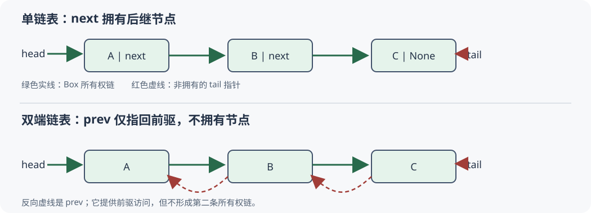

# 链表：单向拥有与双向连接

链表把序列拆成独立分配的节点，并用链接表达顺序。节点不需要相邻存放，插入或删除节点时也不用像数组那样移动后续元素；代价是每个节点需要链接字段，按位置查找仍需从端点逐个前进。

本项目有 `SinglyLinkedList<T>` 和 `DoublyLinkedList<T>`。两者都拥有元素并维护头、尾和长度；它们的区别在于节点是否保存前驱链接，以及因此能否常数时间移除尾节点。

::: {.callout-tip}
## 学完本章，你应该能够

- 画出空表、单节点和多节点时的头尾状态。
- 解释前向 `Box` 链如何拥有节点，非拥有尾指针如何加速尾部访问。
- 推导单链表为何不能常数时间删除尾节点，以及双端链表如何解决。
- 追踪迭代器的借用边界和消费迭代器的所有权移交。
- 说明链表 `Drop` 为何逐节点断开链接。
:::

## 从接口看差异

```rust
use data_structures::{DoublyLinkedList, SinglyLinkedList};

let mut singly = SinglyLinkedList::new();
singly.push_back("B");
singly.push_front("A");
singly.push_back("C");
assert_eq!(singly.front(), Some(&"A"));
assert_eq!(singly.back(), Some(&"C"));
assert_eq!(singly.pop_front(), Some("A"));

let mut doubly = DoublyLinkedList::new();
doubly.push_back(1);
doubly.push_back(2);
assert_eq!(doubly.pop_back(), Some(2));
```

| 操作 | 单链表 | 双端链表 |
|---|---|---|
| 长度与空状态 | `len()`、`is_empty()` | `len()`、`is_empty()` |
| 加入头部 | `push_front(value)` | `push_front(value)` |
| 加入尾部 | `push_back(value)` | `push_back(value)` |
| 移除头部 | `pop_front()` | `pop_front()` |
| 移除尾部 | 未提供 | `pop_back()` |
| 查看端点 | `front/back` 及可变版本 | `front/back` 及可变版本 |
| 清空 | `clear()` | `clear()` |
| 遍历 | 前向共享、可变、消费迭代 | 前向共享/可变；共享和消费迭代可双向 |
| 常用 trait | `Default`、`Clone`、`FromIterator`、`Extend`、`IntoIterator` | 同类 trait |

缺少单链表 `pop_back` 是结构约束：尾指针能直接到最后一个节点，却无法从该节点找到它的前一个节点。若要删除最后一个节点，必须先从头遍历到倒数第二个，成本为 `O(n)`；当前 API 不提供该操作。

## 节点所有权与状态不变量

两种链表都用 `Option<Box<Node<T>>>` 的 `next` 链接拥有后续节点。`Box` 指向堆上的稳定地址；移动链表对象不会移动这些节点本身。链表额外维护 `tail` 非拥有指针，让尾部操作无需遍历整个链。

单链表节点结构可简化为：

```text
Node { value, next: Option<Box<Node>> }
List { head: Option<Box<Node>>, tail: Option<NonNull<Node>>, len }
```

双端链表节点多一个 `prev` 非拥有指针。只有 `next` 链负责拥有节点，`prev` 与 `tail` 都只是指向仍由头部链拥有的节点。逻辑关系如下：

{#fig-list-links width=100%}

两种实现都必须维持这些条件：

1. `len == 0` 时 `head`、`tail` 都为空；`len > 0` 时二者都指向活节点。
2. 从 `head` 沿 `next` 恰好经过 `len` 个节点后结束，最后一个节点就是 `tail`。
3. 尾节点的 `next` 为空；双端链表的头节点 `prev` 为空。
4. 双端链表中，相邻节点的前向与后向关系相互对应。

### 从空表到多节点：跟踪端点状态

下面把 `push_back(A)`、`push_back(B)`、`pop_front()` 连起来看。方括号表示节点；`next` 链拥有后续节点，`tail` 只是指向最后一个节点的非拥有引用。

```text
空表：       head = None                         tail = None   len = 0
加入 A：     head → [A] ← tail                                len = 1
加入 B：     head → [A] → [B] ← tail                         len = 2
移除 A：     head ─────────→ [B] ← tail                      len = 1
再移除 B：   head = None                         tail = None   len = 0
```

双端链表还需在每次变更时保持反向链接：新头的 `prev` 必须为空，新尾的 `next` 必须为空。单节点状态尤其重要：唯一节点同时是头和尾；删除它后两个端点都必须清空。很多链表错误正是因为只更新了拥有链，却漏掉了尾指针或前驱链接。

## 单链表的头尾操作

### 头部插入与移除

`push_front(x)` 创建新节点，把原 `head` 接到新节点后面，再将新节点设为 `head`。若原表为空，新节点也是最后一个节点，所以 `tail` 也指向它。只改常数个字段，时间为 `O(1)`。

`pop_front()` 取走头节点的 `Box`，把它的 `next` 接管为新头，再移交节点中的值。如果链表因此变空，同时清空 `tail`。这同样是 `O(1)`。

### 尾部插入

有尾指针后，`push_back(x)` 可直接把新节点接到尾节点的 `next`，然后更新 `tail`。空表时，新节点同时成为 `head` 和 `tail`。因此头尾插入均为 `O(1)`。

当前 Rust 类型无法直接从保存的裸指针借用并修改尾节点，所以实现的局部操作使用 `unsafe`。安全依据是：尾指针始终指向由 `head` 所有的最后节点；`&mut self` 保证没有其他并行的可变访问；节点在写链接前仍然存活。安全抽象要求所有结构变更都保持尾指针不悬空。

## 双端链表的尾部删除

双端链表尾节点保存 `prev`，因此 `pop_back()` 可直接找到前驱。多节点情况下，取走前驱拥有的 `next` 节点，把前驱设为新尾部，再移交被删节点的值。单节点情况单独处理：清空头尾并将长度设为零。

下图用三个节点展示双端链表移除尾部后的变化：原尾节点从前驱的拥有链接中取下，前驱成为新尾部。

```text
操作前： head → [A] ⇄ [B] ⇄ [C] ← tail
删除 C： head → [A] ⇄ [B] ← tail       返回 C
```

头尾插入、删除和端点访问都是 `O(1)`。单链表不能只靠尾指针完成同一操作，因为它没有从 C 到 B 的反向链接。

## 用小例子理解链表的用途

### 用单链表实现先进先出的处理队列

队列从尾部接收新任务，从头部取出最早的任务。单链表的 `push_back` 和 `pop_front` 都是 `O(1)`，因此适合这个端点操作模式：

```rust
use data_structures::SinglyLinkedList;

let mut jobs = SinglyLinkedList::new();
jobs.push_back("编译");
jobs.push_back("测试");
jobs.push_back("打包");

assert_eq!(jobs.pop_front(), Some("编译"));
assert_eq!(jobs.pop_front(), Some("测试"));
jobs.push_back("部署");
assert_eq!(jobs.pop_front(), Some("打包"));
assert_eq!(jobs.pop_front(), Some("部署"));
assert_eq!(jobs.pop_front(), None);
```

这个例子展示了链表能提供的直接价值：两端的局部操作不需要搬移其他元素。若还需要容量上限、缓存友好的连续存储或队列专用接口，环形缓冲区通常更合适；链表也不是所有队列的默认最佳实现。

### 从两端读取同一条序列

双端链表的共享迭代器可从前后两端交替读取。`remaining` 让迭代器知道还剩多少元素，游标相遇后不会重复返回中间元素：

```rust
use data_structures::DoublyLinkedList;

let mut path = DoublyLinkedList::new();
path.push_back("入口");
path.push_back("大厅");
path.push_back("书房");
path.push_back("出口");

let mut ends = path.iter();
assert_eq!(ends.next(), Some(&"入口"));
assert_eq!(ends.next_back(), Some(&"出口"));
assert_eq!(ends.next(), Some(&"大厅"));
assert_eq!(ends.next_back(), Some(&"书房"));
assert_eq!(ends.next(), None);
```

这类遍历适合从两端向中间检查序列。若要判断回文，可逐对比较两端元素；对不支持 `Eq` 的元素，也可以只观察两端并按业务规则比较。

### 借用遍历与消费遍历的区别

共享迭代只借出元素，可继续使用链表；消费迭代会取得链表所有权，并逐个移交元素：

```rust
use data_structures::SinglyLinkedList;

let mut values = SinglyLinkedList::new();
values.push_back(2);
values.push_back(4);
values.push_back(6);

let doubled: Vec<_> = values.iter().map(|value| value * 2).collect();
assert_eq!(doubled, vec![4, 8, 12]);
assert_eq!(values.front(), Some(&2)); // 共享迭代后仍可使用原链表

let owned: Vec<_> = values.into_iter().collect();
assert_eq!(owned, vec![2, 4, 6]);
```

消费迭代器适合把链表转换成其他容器或把元素交给后续处理；它不需要克隆元素，但链表本身在移交后不能再使用。

## 迭代器与所有权

共享迭代器产出 `&T`，可变迭代器产出互不重叠的 `&mut T`，消费迭代器则逐个移出 `T`。两类列表都支持按顺序遍历和 `IntoIterator`；双端链表的共享迭代器与消费迭代器还实现双向迭代，可以交替从两端读取。

迭代器借用整个链表期间，Rust 不允许同时修改链表结构。单链表迭代器记录下一个节点的借用和剩余元素数；双端共享迭代器还记录尾节点，并用 `remaining` 保证前后游标相遇后停止，避免同一节点被重复产出。

## 析构与长链

若直接丢弃头节点，`Box` 的 `next` 所有权链可能递归析构：每个节点销毁时又销毁后继。特别长的链会形成很深的调用链。两个实现的 `Drop` 都改为循环取走头节点，并先把它的 `next` 断开，再继续处理后继，从而避免递归地销毁整条链。双端链表的 `prev` 和 `tail` 不拥有节点，不参与递归释放。

## 复杂度速查

令 `n` 为节点数：

| 操作 | 单链表 | 双端链表 |
|---|---:|---:|
| `push_front` / `pop_front` | `O(1)` | `O(1)` |
| `push_back` | `O(1)`，维护尾指针 | `O(1)` |
| `pop_back` | 未提供；若遍历实现则 `O(n)` | `O(1)` |
| `front` / `back` | `O(1)` | `O(1)` |
| 遍历或按序找到第 i 个元素 | `O(n)` | `O(n)` |

每个节点单独分配并包含链接字段，因此有额外空间和分配成本。链表的渐进插入成本优势通常要求已经持有插入位置的节点/游标；仅按索引找位置仍要 `O(n)` 遍历。本项目当前 API 以端点操作为主，没有暴露任意节点游标。

## 何时选链表，何时选 Vector

链表适合按端点不断加入或移除元素，或需要稳定地逐个消费节点的场景。若程序主要按下标读取、反复遍历，或需要把元素紧凑地交给缓存友好的批量处理，通常应优先选 `Vector<T>`。连续存储让下标访问为 `O(1)`，尾部追加为摊还 `O(1)`；中间插入和删除仍需移动后续元素。链表避免了这类元素搬移，但每个节点要单独分配，按下标找位置仍是 `O(n)`。

| 需求 | 更合适的选择 | 原因 |
|---|---|---|
| 频繁按下标读取或覆盖 | `Vector<T>` | 连续存储，下标访问 `O(1)` |
| 反复从头部加入、移除 | 链表 | 头部操作 `O(1)`，无需移动剩余元素 |
| 频繁从两端加入、移除 | `DoublyLinkedList<T>` | 两端操作均为 `O(1)` |
| 只在尾部追加，再按顺序遍历 | 通常 `Vector<T>` | 摊还 `O(1)` 追加，较少分配且局部性更好 |
| 已定位节点后还要局部改链 | 需要游标的链表 API | 本项目未公开节点游标，现有 API 不提供此类操作 |

“链表在已知位置插入和删除是 `O(1)`”需要谨慎理解：复杂度只计算改链接的步骤，不包括寻找位置的遍历成本；而且本项目把节点和链接封装在内部，没有暴露可长期持有的节点句柄或游标。因此当前教材只把常数时间结论用于已公开的端点操作，不把理论上的游标操作描述成本项目 API。

## 源码导读

- `src/list/singly_linked.rs`：单链节点、头尾状态和端点算法。哪些操作必须同步更新 `tail`？
- `src/list/singly_linked/iter.rs`：三种遍历与消费迭代。迭代器如何只向前推进？
- `src/list/doubly_linked.rs`：双向链接与局部 `unsafe`。`pop_back` 如何安全取得前驱？
- `src/list/doubly_linked/iter.rs`：双端共享/消费迭代。`remaining` 怎样防止游标交错重复？
- 两个列表的 `Drop`：逐节点拆链。为什么取走节点前要先断开 `next`？

## 练习

1. 分别画出空表、单节点和两个节点的 `head`、`tail`、`next`；双端链表还要标出 `prev`。
2. 对单链表 `[A, B, C]` 执行 `pop_front()` 两次，列出每步的长度和头尾；解释最后一次时为何 `tail` 也必须清空。
3. 对双端链表 `[A, B, C]` 执行 `pop_back()`，逐步写出哪些链接变化以及返回哪个值。
4. 用双端迭代器执行 `next()`、`next_back()`、`next()`。`remaining` 在每步如何变化？何时必须返回 `None`？
5. 说明链表为什么适合研究节点所有权，却不一定适合作为频繁按索引读取的默认序列。

## 本章小结

单链表通过前向拥有链连接节点，尾指针使尾部追加和查看保持常数时间，但无法常数时间删除尾部。双端链表增加非拥有前驱链接，以维持两端操作效率。裸指针和 `unsafe` 的正确性依赖于节点始终由前向 `Box` 链拥有、尾指针及时更新以及独占可变访问；迭代和析构也必须尊重同一套所有权关系。
