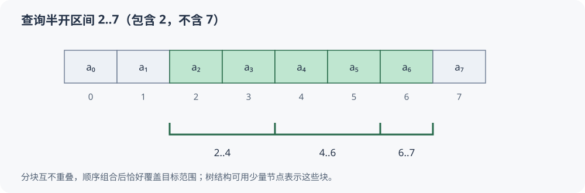

# 区间查询与集合连通性

数组区间上的问题通常需要重复计算某个范围的和、最小值或其他聚合。逐项扫描一次需要 `O(n)`；Fenwick 树、线段树和稀疏表通过预先组织部分结果，换取更快查询。并查集处理的是另一类问题：动态合并集合并判断两个元素是否连通。

本章所有区间 API 使用半开区间 `start..end`，包含 `start`、不包含 `end`。合法区间满足 `start <= end <= len`，但不同结构对空区间有不同约定，需按各自 API 判断。

::: {.callout-tip}
## 学完本章，你应该能够

- 区分并查集的“合并/连通”问题与序列的“区间聚合”问题。
- 推导 Fenwick 树如何用最低有效位跳转汇总前缀。
- 解释线段树如何把任意区间拆成少量节点区间。
- 说明惰性更新为何需要定义更新对聚合的作用及更新的复合顺序。
- 判断稀疏表能否用于某个聚合，尤其是幂等条件与静态数据限制。
:::

## 并查集：跟踪不相交集合

`DisjointSet::new(n)` 创建 `0..n` 中每个元素各自独立的单元素集合。`find(x)` 返回代表元并压缩查找路径；`union(a,b)` 合并两个集合，按大小把较小树挂到较大树下。

```rust
use data_structures::DisjointSet;

let mut sets = DisjointSet::new(5);
assert_eq!(sets.union(0, 1), Some(true));
assert_eq!(sets.union(1, 2), Some(true));
assert_eq!(sets.connected(0, 2), Some(true));
assert_eq!(sets.component_count(), 3);
```

`parent[x]` 指向父节点，根节点满足 `parent[root] == root`；只有根节点上的 `size` 有意义；`components` 等于根节点数。路径压缩和按大小合并共同使一系列操作的摊还成本为 `O(α(n))`，其中 `α` 是增长极慢的反 Ackermann 函数。空间 `O(n)`。

索引越界时 `find` 返回 `None`，依赖它的 `union`、`connected` 也返回 `None`。重复合并同一集合返回 `Some(false)`，不会减少分量数。并查集不支持拆分集合，也不维护成员顺序。

### 应用：合并重复账户群组

账户导入时，外部规则可能确认两个用户记录属于同一人。并查集可以逐步合并关系，再查询两条记录是否已连通；它不负责保存用户名或找出组内成员列表：

```rust
use data_structures::DisjointSet;

let mut accounts = DisjointSet::new(5); // 导入批次中的五条记录
accounts.union(0, 3); // 相同验证邮箱
accounts.union(1, 3); // 相同手机号
accounts.union(2, 4); // 另一组重复账户

assert_eq!(accounts.connected(0, 1), Some(true));
assert_eq!(accounts.connected(0, 2), Some(false));
assert_eq!(accounts.component_count(), 2);
```

若之后发现误合并，普通并查集不能拆开它；需要可回滚并查集或离线时间线算法。代表元只是内部代表，不应当作账户的永久主键。

## 区间结构共有的代数约定

区间查询常把一段数据折叠成一个值。若拆分或重新组合子区间，聚合操作通常需要满足结合律：`(a ⊕ b) ⊕ c = a ⊕ (b ⊕ c)`。若空区间也要有结果，还需要单位元 `e`，使 `e ⊕ a = a ⊕ e = a`；二者构成幺半群（monoid）。

项目的 `Monoid` trait 用类型级的 `identity` 和 `combine` 表示全定义的结合操作；`TryMonoid` 允许组合返回错误。trait 的代数定律无法由 Rust 类型系统验证，使用者必须保证实现符合契约。非交换操作也可以用于线段树；查询实现会保持从左到右的组合顺序。

## Fenwick 树：前缀和的位运算分块

`FenwickTree` 固定存储 `i64` 和，支持单点增量与前缀/区间求和。内部用 1 起始索引保存部分区间和；`i & -i`（代码中使用 `wrapping_neg`）取出最低有效位，决定当前节点覆盖长度以及查询时向前跳回多少位置。

对数组 `[3, -2, 5, 4]`，`prefix_sum(3)` 表示 `0..3`，结果为 6；`range_sum(1,4)` 是 `prefix(4)-prefix(1)`，结果为 7。

```rust
use data_structures::FenwickTree;

let mut sums = FenwickTree::from_values(&[3, -2, 5, 4]);
assert_eq!(sums.prefix_sum(3), Some(6));
assert_eq!(sums.range_sum(1, 4), Some(7));
sums.add(1, 6); // 将位置 1 增加 6
assert_eq!(sums.range_sum(1, 4), Some(13));
```

`from_values` 为 `O(n)`；单点 `add`、前缀和与区间和均为 `O(log n)`；空间 `O(n)`。Fenwick 树的这组 API 表达的是增量更新，而非任意单点赋值。索引越界或区间不满足 `start <= end <= len` 时返回 `None`；空区间返回 0。所有中间和与最终结果都必须能表示为 `i64`，此实现不返回溢出错误。

它适合“值只通过增量变化”的计数场景，例如逐小时流量。若某小时新增 12 次访问，应调用 `add(hour, 12)`；若需要把该小时总数直接改成某个目标值，应先读取旧值、计算差值后再加，或改用支持单点赋值的线段树。

## 线段树：区间拆分与单点赋值

`SegmentTree<T>` 将叶子放在大小为 2 的幂的平坦数组区域，未使用叶子填入聚合单位元。父节点保存左右子区间的聚合。建树 `O(n)`，单点 `set` 和区间 `query` 为 `O(log n)`，空间 `O(n)`。

查询半开区间时，从左右端点向树根移动；若某个节点区间恰好完整落在目标范围内，就把其聚合并入结果。左右结果分开累积，保证非交换聚合也按原序组合。

{#fig-range-decomposition width=100%}

```rust
use data_structures::SegmentTree;

let mut sums = SegmentTree::from_values(&[2, 4, -1, 6, 3])?;
assert_eq!(sums.range_sum(1, 4)?, Some(9));
sums.set(2, 5)?;
assert_eq!(sums.range_sum(1, 4)?, Some(15));
# Ok::<(), data_structures::SumOverflow>(())
```

此处求和用 `i64` 的 checked addition；溢出会返回 `SumOverflow`。`set` 会先计算更新路径上的新聚合，若任一步失败则不修改树。合法空区间返回单位元；越界或反向区间返回 `Ok(None)`。注意这是库中 `SegmentTree` 的错误协议，不能直接推广到 Fenwick 树。

自定义聚合类型可实现 `Monoid` 或 `TryMonoid`。聚合必须满足结合律与单位元约定；若操作有方向性，左右组合顺序仍然重要。

## 惰性线段树：把整段更新暂存起来

普通线段树逐个修改区间内每个叶子会很慢。`LazySegmentTree<S>` 允许调用者通过 `LazySegmentTreeSpec` 定义：

- `Value` 与 `Update` 类型；
- 聚合 `combine` 和单位元 `identity`；
- 一个更新如何作用于长度为 `segment_len` 的区间聚合 `apply`；
- 两个更新按时间顺序如何合并 `compose(old, new)`（先 old，后 new）。

若查询或更新完整覆盖某个节点区间，树直接更新该节点聚合并保存待下传标签；只有后续操作深入子区间时才把标签推给孩子。典型区间更新和查询为 `O(log n)`，建树和空间为 `O(n)`。

示例规格可对区间每个元素加 `delta`，并用区间和作为聚合：长度为 `m` 的段，其和增加 `delta*m`；连续两次加法的标签组合为相加。对非交换更新（例如赋值与加法混用），必须严格定义复合顺序。规格实现还需保证 `apply` 与 `combine` 一致，并自行确定数值溢出策略。

惰性树的 `query` 接收 `&mut self`，因为查询可能把待处理标签向下推；查询逻辑值虽不变，内部表示可能改变。非法区间返回 `None`，合法空区间返回 `identity`，空树的 `query(0,0)` 与空更新也有定义。

### 完整规格示例：区间加价与区间总额

下面的 `RangeAddSum` 定义了“区间中每个元素加上 `delta`”和“查询区间总和”。覆盖长度为 `m` 的节点时，总和增加 `delta × m`；两次加法按时间顺序合成为两者之和：

```rust
use data_structures::{LazySegmentTree, LazySegmentTreeSpec};

struct RangeAddSum;
impl LazySegmentTreeSpec for RangeAddSum {
    type Value = i64;
    type Update = i64;
    fn identity() -> i64 { 0 }
    fn combine(left: &i64, right: &i64) -> i64 { left + right }
    fn apply(delta: &i64, sum: &i64, segment_len: usize) -> i64 {
        sum + delta * segment_len as i64
    }
    fn compose(old: &i64, new: &i64) -> i64 { old + new }
}

let mut hourly_rates = LazySegmentTree::<RangeAddSum>::from_values(&[10, 10, 10, 10]);
hourly_rates.update_range(1, 4, 3).unwrap(); // 给后三小时统一加价
assert_eq!(hourly_rates.query(0, 4), Some(49));
hourly_rates.update_range(2, 3, 5).unwrap(); // 单独调整第三小时
assert_eq!(hourly_rates.query(2, 4), Some(28));
```

该规格默认 `i64` 运算不会溢出；生产代码若输入规模或金额不受控，应使用 checked 运算或更宽的数值类型。赋值更新与加法更新混用时，`compose(old, new)` 必须编码“先旧后新”，不能简单相加。

## 稀疏表：静态、幂等查询

`SparseTable<T, O>` 预处理不同长度的二次幂区间，适合数据固定且查询很多的最小值/最大值。构建时间和空间 `O(n log n)`，非空范围查询 `O(1)`，不支持更新。

查询把目标范围覆盖成两个可能重叠的幂次长度区间，再组合二者结果。重叠元素会被计算两次，因此操作必须幂等：`combine(x,x) = x`；同时还需结合律，以便预计算不同分块的结果。最小值和最大值满足这些条件；求和不满足幂等性，不能直接使用这种 O(1) 查询方式。

稀疏表要求 `start < end <= len`；空区间、越界和反向区间都返回 `None`。若数据变化，应重新构建表。

```rust
use data_structures::range::{Maximum, Minimum, SparseTable};

let daily_low = [11, 7, 9, 3, 8, 6]; // 已结束月份的最低气温
let minima = SparseTable::new(&daily_low, Minimum);
let maxima = SparseTable::new(&daily_low, Maximum);
assert_eq!(minima.query(1, 5), Some(3));
assert_eq!(maxima.query(1, 5), Some(9));
```

这是静态历史数据的好选择：先花 `O(n log n)` 预处理，之后可用 `O(1)` 回答大量最小/最大值查询。若气温记录会被修订，稀疏表没有更新 API，需要重建；若要同时处理动态更新，应选线段树或其他结构。

## 结构对照

| 结构 | 更新 | 查询 | 主要前提 | 空区间 |
|---|---|---|---|---|
| DisjointSet | 合并集合 | 同组判断 | 固定整数域；不可拆分 | 不适用 |
| FenwickTree | 单点加增量 | 前缀/区间和 | `i64` 中间结果不溢出 | 返回 0 |
| SegmentTree | 单点赋值 | 一般结合聚合 | monoid；可报告聚合错误 | 返回单位元 |
| LazySegmentTree | 区间更新 | 一般聚合查询 | 更新与聚合规格一致 | 返回单位元/空操作 |
| SparseTable | 不支持更新 | 静态区间聚合 | 结合且幂等 | 返回 `None` |

### 选型时先看更新方式

| 任务特征 | 先考虑 | 不适合的情况 |
|---|---|---|
| 只合并连通关系、判断是否同组 | `DisjointSet` | 要删除关系或列出有序成员 |
| 单点增量更新、频繁前缀和 | `FenwickTree` | 需要最小值或任意单点赋值 |
| 单点赋值与一般区间聚合 | `SegmentTree` | 只要简单前缀和且希望更少常数开销 |
| 整段更新并查询聚合 | `LazySegmentTree` | 更新无法用规格定义成一致的代数作用 |
| 数据不更新、查询静态最值很多 | `SparseTable` | 求和等非幂等操作，或数据会改变 |

## 源码导读

- `src/range/disjoint_set.rs`：路径压缩、按大小合并。为什么代表元不是稳定 ID？
- `src/range/fenwick.rs`：低位区间和与前缀跳转。`index & -index` 怎样决定覆盖范围？
- `src/range/segment_tree.rs`：平坦树、左右累积与 checked 聚合。失败更新如何保持原状态？
- `src/range/lazy_segment_tree.rs`：待推标签、更新应用和复合。为什么 compose 的 old/new 顺序重要？
- `src/range/sparse_table.rs`：幂次区间预处理和 O(1) 查询。两个区间重叠为何要求幂等？
- `src/algebra/monoid.rs` 与 `src/algebra/try_monoid.rs`：聚合代数契约。哪些代数性质无法由 trait 检查？

## 练习

1. 从并查集 6 个单元素集合开始执行 `union(0,1)`、`union(2,3)`、`union(1,3)`，画出 parent/size，并统计分量数。
2. 对 Fenwick 数组 `[3,-2,5,4]`，逐步展开 `prefix_sum(4)` 访问的内部索引与其覆盖区间。
3. 将区间 `2..7` 拆成线段树节点区间，并解释为什么这些覆盖段不重叠且完整覆盖目标。
4. 连续执行区间加 5、再加 2。写出 `compose(old,new)` 结果；若第二个操作改为区间赋值 0，为什么仅记录一个加数不够？
5. 用 `[7,2,9,4,6]` 查询最小值 `1..5`。指出稀疏表两段覆盖在哪里重叠，以及重复元素为何不影响最小值。
6. 说明为什么稀疏表更新一个元素后，原有预处理值不能继续保证查询正确。

## 本章小结

并查集用代表元和合并策略维护动态连通分组。Fenwick 树以位运算组织前缀和；线段树用可组合区间应对一般更新/查询；惰性线段树延迟传播整段更新；稀疏表用更多预处理换静态幂等查询的常数时间。区间边界、代数定律和溢出行为都是 API 语义的一部分。
