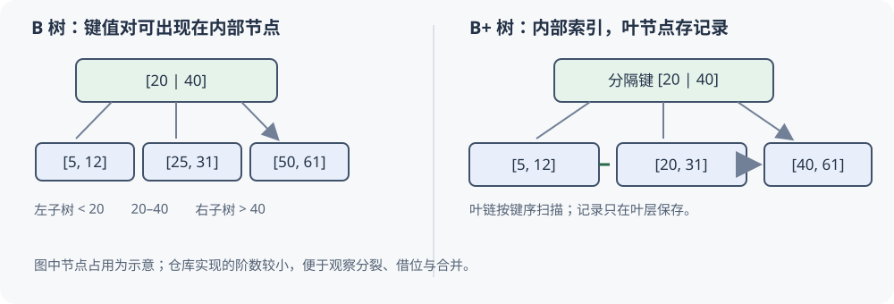
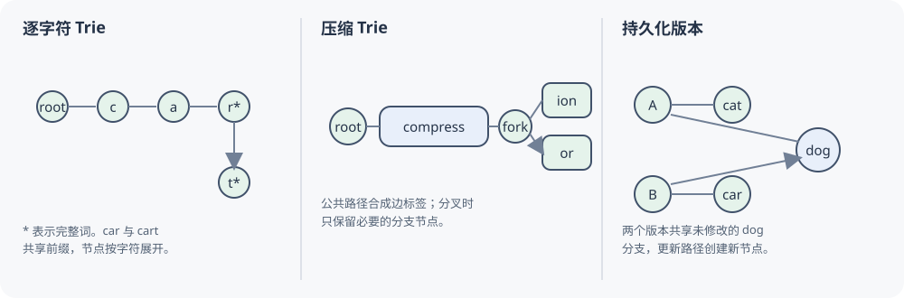

# 多路树与前缀树

二叉树每个节点最多有两个孩子。B 树和 B+ 树在一个节点中保存多个键，以较大的分支数降低层数；Trie 则按字符串中的字符组织路径，擅长前缀查询。它们仍然是树，但节点不变量和适用任务不同。

## B 树：节点内保存键和值

本项目 `BTreeMap<K, V>` 是一个 2–3–4 B 树。每个节点保存 1 到 3 个有序键值对（根节点有相应的空树例外），并可有 2 到 4 个子节点。节点中的键划分子树范围，所有叶节点保持在同一深度。

```text
                 [ 20 | 40 ]
               /      |       \
          keys <20  20..40   keys >40
```

查找在当前节点的有序键中定位目标或应进入的子树。插入遇到满节点会先分裂，把中间键提升到父节点；删除时若子节点键数不足，则从相邻兄弟借键或与兄弟合并。根分裂可增加一层，根删除后若只剩一个孩子则收缩一层。

每层至多检查常数个键（本实现每节点最多 3 个），树高为 `O(log n)`，查找、插入和删除均为 `O(log n)`。这是用于展示分裂、借位和合并机制的小阶数实现，不针对磁盘页或特定 CPU 缓存做生产级调优。`height()` 返回层数，空树为 0。

## B+ 树：索引在内部，记录在叶子

`BPlusTreeMap<K, V>` 把内部节点用于导航：内部节点保存分隔键，键值记录只存于叶节点。叶节点按顺序链接，因此迭代可以从首叶沿叶链扫描，不必每次回到根重新遍历。叶最多保存 3 个条目，内部节点最多有 4 个孩子；分裂、借位和合并维持最小占用与叶层同深。

```text
            internal separators
                 [ 20 | 40 ]
                /     |      \
leaves:   [5, 12] → [20, 31] → [40, 55, 61]
```

查找沿内部索引到达叶子，再在叶子中确认键。插入和删除在叶子处理条目，必要时向父节点传播分裂或修复占用。树高相关操作为 `O(log n)`；按序完整迭代为 `O(n)`，且通过叶链顺序前进。实现使用节点 ID 的 arena 管理内部节点，并复用节点槽位；这个布局便于显式处理分裂和快照。

`BTreeSet` 和 `BPlusTreeSet` 分别以映射到 `()` 的方式复用对应 map 的排序与结构逻辑。

{#fig-multiway-trees width=100%}

### 用 B 树映射维护有序配置清单

部署工具可以按服务名保存当前配置版本，再按名称输出一份可复现的清单。`BTreeMap` 的迭代顺序由键决定，不依赖配置写入的先后：

```rust
use data_structures::BTreeMap;

let mut versions = BTreeMap::new();
versions.insert("worker", 12);
versions.insert("api", 8);
versions.insert("scheduler", 5);

let manifest: Vec<_> = versions.iter().map(|(&service, &version)| (service, version)).collect();
assert_eq!(manifest, [("api", 8), ("scheduler", 5), ("worker", 12)]);
versions.insert("api", 9); // 发布新配置时更新该服务的版本
```

同样的需求若还要维持大量叶层顺序扫描，可考虑 B+ 树映射；本项目 B 树和 B+ 树都使用小阶数，适合学习分裂与叶链算法，不代表已经针对生产环境调优。

只需要保存唯一版本号而不需要关联值时，`BTreeSet` 会更直接：

```rust
use data_structures::{BPlusTreeSet, BTreeSet};

let mut deployed = BTreeSet::new();
for version in [104, 101, 104, 108, 101] {
    deployed.insert(version);
}
assert_eq!(deployed.iter().copied().collect::<Vec<_>>(), [101, 104, 108]);
deployed.remove(&104); // 回滚版本后从活动集合移除
assert_eq!(deployed.iter().copied().collect::<Vec<_>>(), [101, 108]);

let mut scanned = BPlusTreeSet::new();
for version in [104, 101, 104, 108, 101] {
    scanned.insert(version);
}
assert_eq!(scanned.iter().copied().collect::<Vec<_>>(), [101, 104, 108]);
```

`BPlusTreeSet` 提供相同的有序集合语义，底层复用 B+ 树。若应用同时需要大量顺序扫描，可以比较叶层布局上的差异；公开 API 当前没有从指定下界开始的范围迭代器。

### 用 B+ 树维护有序时间表

B+ 树适合在键序稳定的情况下持续更新记录，并沿叶链顺序扫描。例如把分钟数作为键，可生成接下来最早的几项安排：

```rust
use data_structures::BPlusTreeMap;

let mut schedule = BPlusTreeMap::new();
schedule.insert(540, "晨会");
schedule.insert(615, "代码评审");
schedule.insert(720, "发布窗口");
schedule.insert(600, "设计讨论");

let next_events: Vec<_> = schedule
    .iter()
    .take(3)
    .map(|(&minute, &event)| (minute, event))
    .collect();
assert_eq!(next_events, [(540, "晨会"), (600, "设计讨论"), (615, "代码评审")]);
```

这里从根定位首叶并顺序读取 `k` 项，成本为 `O(log n + k)`。但 API 尚未提供从某个时间下界直接开始的范围迭代器；若要查询“下午 1 点之后的安排”，目前只能从头迭代并过滤。B+ 树的叶链为顺序扫描提供了基础，范围起点定位仍是值得补足的接口。

## Trie：按 Unicode 字符共享前缀

普通 `Trie` 用一个字符一条边。节点另有 `is_word` 标记，表示当前路径本身是否构成完整单词。于是 `car` 与 `cart` 可共享 `c-a-r` 路径，同时在 `r` 节点标记 `car` 是完整词。

仓库按 Unicode 标量值（Rust `char`）处理字符串，而非按 UTF-8 字节拆分。子边保存在 `BTreeMap<char, Node>`，因此迭代按字典序输出。长度为 `k` 个 Unicode 标量值的查找、插入和删除为 `O(k log d)`，`d` 是节点最大分支数；删除后会裁掉不再被其他词使用的节点。空字符串也可由根节点的 `is_word` 表示。

```rust
use data_structures::Trie;

let mut words = Trie::new();
words.insert("猫");
words.insert("猫咪");
assert!(words.contains("猫"));
assert!(words.starts_with("猫"));
assert!(!words.contains("猫科"));
```

### 用 Trie 提供前缀候选

命令面板、词典和搜索框通常需要按用户已经输入的前缀列出候选词。`words_with_prefix` 从前缀对应的节点开始遍历，只访问匹配子树，并按字典序产生完整单词：

```rust
use data_structures::Trie;

let mut commands = Trie::new();
for command in ["commit", "compare", "compress", "checkout", "clone"] {
    commands.insert(command);
}

let suggestions: Vec<_> = commands.words_with_prefix("com").collect();
assert_eq!(suggestions, ["commit", "compare", "compress"]);
assert!(commands.words_with_prefix("xyz").next().is_none());
```

`starts_with("com")` 只回答“是否至少有一个候选”；`words_with_prefix("com")` 才返回候选本身。前缀节点定位成本随前缀长度增长，之后的遍历只经过匹配子树，不必为每个查询扫描整棵 Trie。该 API 当前用于普通 `Trie`；压缩 Trie 和持久化 Trie 仍只有全量字典序迭代及前缀存在性查询。

## 压缩 Trie：把单分支路径收进边标签

`RadixTrie` 将一段连续字符保存在一条边的标签中，减少只有一个孩子且不是单词终点的中间节点。插入新词时，若它在边标签中间分叉，就把边拆成公共前缀和两个后缀；删除后若中间节点不再是单词且只剩一个孩子，就合并边标签。

前缀查询可以在压缩边中间结束。例如标签为 `compression` 的边，前缀 `compres` 虽未走到边末端，仍匹配这条路径。精确查词则必须完整匹配到一个被标为单词的节点。当前 RadixTrie 提供前缀存在性查询，但没有前缀候选迭代器；需要导出候选时只能遍历字典后过滤。该实现同样按 Unicode 标量值处理字符，复杂度以字符数和节点分支查找成本衡量；边标签压缩节点，不会让检查输入字符的成本消失。

压缩 Trie 可用来检查共享路径较多的静态 URL 路由或命令路径：

```rust
use data_structures::RadixTrie;

let mut routes = RadixTrie::new();
routes.insert("/api/v1/users");
routes.insert("/api/v1/orders");
routes.insert("/api/v2/health");

assert!(routes.starts_with("/api/v1"));
assert!(routes.contains("/api/v1/users"));
assert!(!routes.contains("/api/v1")); // 前缀存在不代表它是完整路由
```

这只演示静态路径的前缀判断；真实路由还需要处理 HTTP 方法、参数段、通配符和匹配优先级。

## 持久化 Trie：更新产生新版本

`PersistentTrie` 的 `insert` 和 `remove` 以 `&self` 为输入并返回 `(新版本, 是否改变)`。更新路径上的节点被复制，未修改子树用 `Arc` 共享。旧版本因此保持原有内容，可用于历史快照或分支探索。

```rust
use data_structures::PersistentTrie;

let empty = PersistentTrie::new();
let (cats, _) = empty.insert("猫");
let (more, _) = cats.insert("猫咪");
assert!(cats.contains("猫"));
assert!(!cats.contains("猫咪"));
assert!(more.contains("猫咪"));
```

### 以持久化 Trie 管理候选命令版本

编辑器插件或 CLI 可以为一次试验创建新的命令目录版本，而不影响仍使用旧目录的会话：

```rust
use data_structures::PersistentTrie;

let stable: PersistentTrie = ["build", "check", "test"]
    .into_iter()
    .map(str::to_owned)
    .collect();
let (preview, inserted) = stable.insert("bench");

assert!(inserted);
assert!(!stable.contains("bench"));
assert!(preview.contains("bench"));
```

新版本只复制更新路径，其他子树由 `Arc` 共享；这提供内存中的快照，不会自动将数据保存到磁盘。

长度为 `k` 的更新至少要沿路径访问字符，并复制路径上的节点及其子节点映射；本实现的分支映射是 `BTreeMap<char, Arc<Node>>`，因此每层的子边查询/更新还随分支数增长。未发生变化（重复插入或删除缺失词）时会复用原根。`Arc` 的引用计数和路径复制需要额外成本，换来多个版本共享结构。

{#fig-trie-variants width=100%}

## 有序映射接口

仓库还提供 `BinarySearchTreeMap`、`RecursiveBinarySearchTreeMap`、`AvlTreeMap` 和 `RedBlackTreeMap`，通过共同的 `TreeMap<K, V>` trait 暴露 `insert`、`get`、`get_mut`、`remove`、`len` 与升序 `iter`。这些映射复用上一章相应二叉搜索树机制；选择普通 BST 要接受树高取决于输入顺序，选择 AVL/红黑映射则获得对数级操作界限。

`BTreeMap` 与 `BPlusTreeMap` 同样有序，分别用于讲解节点内多键维护与叶层顺序扫描。`PersistentAvlTreeMap` 是返回新版本的持久化映射，将在高级结构章节讨论路径复制和平衡修复。

持久化 AVL 映射适合读者需要继续查询旧快照、写者同时准备新版本的配置表：

```rust
use data_structures::PersistentAvlTreeMap;

let empty = PersistentAvlTreeMap::new();
let (stable, _) = empty.insert("timeout_ms", 800);
let (stable, _) = stable.insert("retries", 2);
let (preview, old_timeout) = stable.insert("timeout_ms", 1200);

assert_eq!(old_timeout, Some(800));
assert_eq!(stable.get("timeout_ms"), Some(&800));
assert_eq!(preview.get("timeout_ms"), Some(&1200));
```

路径复制要求键和值实现 `Clone`；该结构提供版本快照，不负责磁盘持久化或版本发布协调。

## 复杂度与结构对照

| 结构 | 键/路径存放方式 | 查找/更新 | 有序遍历 | 突出特性 |
|---|---|---:|---:|---|
| BTreeMap | 内部节点和叶节点都存键值对 | `O(log n)` | `O(n)` | 节点分裂、借位、合并 |
| BPlusTreeMap | 记录在叶，内部保存分隔键 | `O(log n)` | `O(n)` | 叶链支持顺序扫描 |
| Trie | 每个字符一条边 | `O(k log d)` | 按字典序 | 前缀查找 |
| RadixTrie | 多字符边标签 | `O(k log d)` 量级 | 按字典序 | 减少单分支节点 |
| PersistentTrie | Arc 共享节点，路径复制 | 随字符数及分支查找增长 | 按字典序 | 保留旧版本 |

`n` 表示树中条目数，`k` 表示字符串字符数，`d` 表示节点最大分支数。复杂度忽略分配器和键比较自身的成本；长字符串键的比较可能还取决于公共前缀长度。

## 源码导读

- `src/tree/b_tree.rs`：B 树节点、插入分裂、删除借位/合并。分裂时中间键为何要进入父节点？
- `src/tree/b_tree/iter.rs`：B 树有序遍历。如何按键、孩子交错顺序遍历？
- `src/tree/b_plus_tree.rs`：arena 节点、分隔键、叶链和重平衡。叶子分裂后怎样更新 `next`？
- `src/tree/trie.rs`：字符子边、终止标记、剪枝和前缀候选迭代。为什么前缀游标从匹配节点开始？
- `src/tree/radix_trie.rs`：压缩边的拆分和合并。分叉发生在边标签内部时如何拆边？
- `src/tree/persistent_trie.rs`：Arc 共享与路径复制。更新路径外的节点为何能共享？
- `src/tree/map.rs` 与 `src/tree/map/backend.rs`：二叉树映射适配器和共同 trait。抽象映射接口如何委托给后端？

## 练习

1. 对 B 树依次插入 `10, 20, 30, 40`。当根节点满时，画出分裂和中间键上升后的结果。
2. 在 B 树中删除一个会使子节点空缺的键，追踪它从兄弟借键或与兄弟合并的路径。
3. 对 B+ 树插入会导致叶分裂的递增键，画出分隔键、叶链接和根变化；再按叶链写出遍历顺序。
4. 向 Trie 插入 `car` 和 `cart`，标出完整词标记；删除 `car` 后为什么 `c-a-r` 路径仍不能剪掉？
5. 向压缩 Trie 插入 `compression` 和 `compressor`，标出公共边标签与分叉位置；删除其中一个词后说明是否能重新合并。
6. 对持久化 Trie 先插入 `cat`，再从新版本插入 `car`。指出两个版本中哪些路径复制、哪些分支共享。
7. 用 Trie 为命令面板查找前缀 `co` 的候选，再比较 `starts_with` 和 `words_with_prefix` 分别适合返回什么结果。

## 本章小结

B 树把多个键放进节点，通过分裂、借位和合并维持平衡；B+ 树把记录集中在叶节点并链接叶层，方便顺序遍历。Trie 沿字符路径索引前缀；压缩 Trie 合并单分支边，持久化 Trie 复制修改路径并共享其他分支。共同的树形外观掩盖了不同的不变量，选择结构时应从查询模式和更新语义出发。
