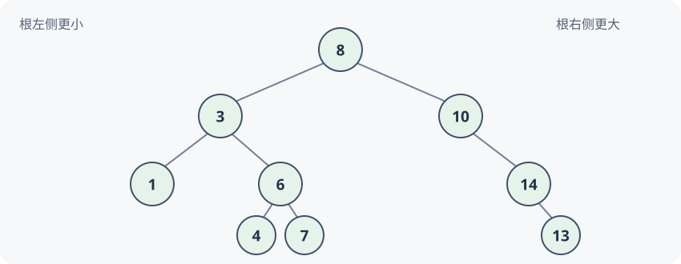
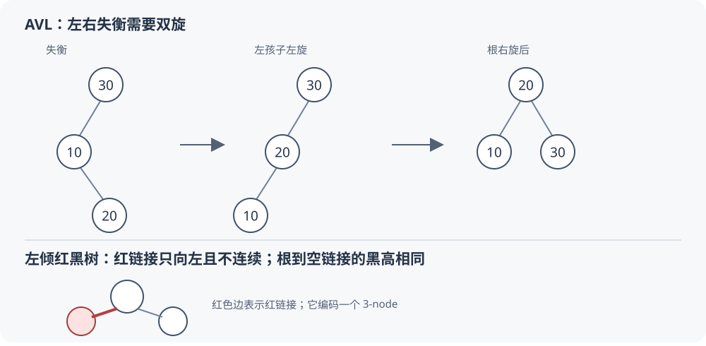

# 二叉搜索树与平衡树

树用父子关系组织元素。二叉搜索树把键的大小关系放进左右子树；平衡树在此基础上限制高度，避免普通搜索树因输入顺序而退化为长链。本章从普通 BST 开始，再比较 AVL 树和左倾红黑树如何保持高度。

仓库提供迭代与递归两种二叉搜索树、AVL 集合、左倾红黑树，以及以这些集合为基础的有序映射类型。本章聚焦集合式树的搜索、插入、删除和不变量。

::: {.callout-tip}
## 学完本章，你应该能够

- 从 BST 的序关系推导查找方向和中序遍历顺序。
- 解释删除叶节点、单子节点和双子节点的不同处理。
- 手动执行 AVL 的单旋和双旋，并说明为什么排序顺序不变。
- 列出左倾红黑树的颜色不变量及其高度保证。
- 区分普通 BST 的 `O(h)` 与平衡树的 `O(log n)`。
:::

## 二叉搜索树：序关系就是导航规则

对每个节点 `x`，其左子树的值小于 `x`，右子树的值大于 `x`。相等值不重复插入。查找时比较目标与当前节点：较小就向左，较大就向右，相等则命中。

```rust
use data_structures::BinarySearchTree;

let mut tree = BinarySearchTree::new();
for value in [8, 3, 10, 1, 6, 14, 4, 7, 13] {
    tree.insert(value);
}

assert!(tree.contains(&6));
assert!(!tree.insert(6)); // 不插入重复值
assert_eq!(tree.iter().copied().collect::<Vec<_>>(), [1, 3, 4, 6, 7, 8, 10, 13, 14]);
assert_eq!(tree.remove(&8), Some(8));
```

如果只关心一组不重复的编号，并且需要按编号导出结果，BST 的集合式 API 可以直接建索引。这里把它用于规模受控的导入批次；若输入可能长期有序增长，则应用应选择平衡树：

```rust
use data_structures::{BinarySearchTree, RecursiveBinarySearchTree};

let mut imported_job_ids = BinarySearchTree::new();
let mut recursive_import = RecursiveBinarySearchTree::new();
for id in [7304, 7288, 7304, 7311] {
    imported_job_ids.insert(id); // 重复 ID 自动拒绝
    recursive_import.insert(id);
}
let canonical_ids: Vec<_> = imported_job_ids.iter().copied().collect();
assert_eq!(canonical_ids, [7288, 7304, 7311]);
assert_eq!(canonical_ids, recursive_import.iter().copied().collect::<Vec<_>>());
```

递归版 `RecursiveBinarySearchTree` 提供相同集合语义，可将同一输入交给两种实现并比较升序结果；它的主要教学价值是展示递归返回时如何带回新的子树根。面对很深的退化树，递归调用深度也会随树高增长。

中序遍历按“左子树、节点、右子树”访问，因此得到升序序列。树的形状取决于插入次序：如果依次插入递增值，每个新节点都落在右侧，BST 退化成链。

{#fig-bst-order width=90%}

### 删除节点的三种情况

删除叶节点只需把父链接置空；删除只有一个孩子的节点，用孩子接替它；若有两个孩子，则找到右子树中的最小节点（中序后继），用后继值替换目标，再从右子树移除原后继节点。后继没有左孩子，因此最后一步归结为至多一个孩子的情况。

本仓库的迭代 BST 通过可变链接逐层向下定位，并用迭代方式取出后继。它也提供递归版本用于比较控制流程。普通 BST 搜索、插入和删除耗时 `O(h)`，其中 `h` 是树高；最坏情况 `h = n`，所以最坏时间为 `O(n)`。

## AVL 树：用高度差控制形状

AVL 树为每个节点保存子树高度，并要求左右子树高度差最多为 1。插入或删除沿递归路径返回时更新高度；若某节点高度差超过 1，就旋转局部子树。旋转只改变链接，不改变节点的中序顺序。

典型的左右（LR）失衡如下：先对左孩子左旋，再对失衡节点右旋。双旋把“折弯”的路径变直，同时保持所有值的排序范围。

```text
失衡：              第一步左旋左孩子：       第二步右旋根：
       30                    30                       20
      /                     /                        /  \
    10                    20                       10    30
      \                  /
       20               10
```

仓库实现也处理右左（RL）情形：先右旋右孩子，再左旋根。LL 与 RR 情形各用一次相反方向的旋转。

AVL 的高度为 `O(log n)`，故查找、插入和删除都为 `O(log n)`。维护高度与旋转增加实现工作；优势是较严格的平衡限制。公开 API 还提供 `height()`，空树高度为 0，叶节点高度为 1。

当只需维护一组在线活跃分区编号时，可直接用 `AvlTree` 去重、查询并按序巡检；与前面的无平衡 BST 相比，它对插入顺序不敏感：

```rust
use data_structures::AvlTree;

let mut active_partitions = AvlTree::new();
for partition in [18, 4, 27, 12, 18] {
    active_partitions.insert(partition);
}
assert!(active_partitions.contains(&12));
assert_eq!(active_partitions.iter().copied().collect::<Vec<_>>(), [4, 12, 18, 27]);
active_partitions.remove(&18); // 分区下线
```

## 左倾红黑树：用颜色编码 2–3 树

仓库实现的是**左倾红黑树**。红链接表示 2–3 树中的键合并关系，并统一要求向左倾斜。实现维护：

1. 根为黑色。
2. 不存在右倾红链接。
3. 红链接不能连续出现。
4. 从根到任一空孩子的路径包含相同数量的黑链接（黑高相同）。

插入新节点时先以红色链接接入，然后沿递归返回路径修复局部状态：右红而左不红时左旋；左侧连续红时右旋；左右孩子都红时翻转颜色。删除前会把红链接向下移动，使待删位置有足够结构可调整；返回时再执行修复。

红黑树限制的形状比 AVL 灵活，但依然保持 `O(log n)` 高度，因此查找、插入和删除均为 `O(log n)`。此处不能把一般红黑树的任意颜色约定直接套到实现上，阅读时要特别留意 `左倾` 条件和删除前的颜色移动。

若维护的是待复核事件 ID 集合而不是键值记录，可使用 `RedBlackTree`。它保留去重和有序遍历语义，同时在任意插入顺序下维持对数高度：

```rust
use data_structures::RedBlackTree;

let mut pending = RedBlackTree::new();
for id in [4102, 3988, 4271, 4102] {
    pending.insert(id);
}
assert_eq!(pending.iter().copied().collect::<Vec<_>>(), [3988, 4102, 4271]);
pending.remove(&4102); // 事件完成复核
```

{#fig-balanced-tree-rules width=100%}

## 三种树的比较

| 结构 | 形状约束 | 查找 | 插入/删除 | 主要代价 |
|---|---|---:|---:|---|
| BST | 只满足左小右大 | `O(h)`，最坏 `O(n)` | `O(h)`，最坏 `O(n)` | 可能因输入次序退化 |
| AVL | 左右子树高度差不超过 1 | `O(log n)` | `O(log n)` | 存高度，必要时旋转 |
| 左倾红黑树 | 左倾红链接、无连续红链、黑高相同 | `O(log n)` | `O(log n)` | 颜色维护与重平衡步骤 |

三者都按 `Ord` 排序、拒绝重复值，并按升序迭代。选择平衡树时，API 使用者通常关心稳定的渐进界限；本项目并不声称某一种实现对所有工作负载都更快。

## 用树做有序索引

树的实际价值通常不是“把数据放在节点里”，而是维护一份按键排序、可持续更新的索引。例如库存系统可以用 SKU 查找记录，并按 SKU 顺序生成补货清单：

```rust
use data_structures::AvlTreeMap;

let mut stock = AvlTreeMap::new();
stock.insert(104, 7); // SKU -> 当前库存
stock.insert(205, 2);
stock.insert(318, 0);
stock.insert(421, 4);

assert_eq!(stock.get(&205), Some(&2));
stock.insert(205, 5); // 同一键更新，仍只有一条记录

let restock: Vec<_> = stock
    .iter()
    .filter_map(|(&sku, &quantity)| (quantity < 5).then_some((sku, quantity)))
    .collect();
assert_eq!(restock, [(318, 0), (421, 4)]);
```

AVL 映射保证查找和更新为 `O(log n)`，`iter()` 按键升序输出。但当前 `TreeMap` 和 B/B+ 树映射接口没有提供带起止键的专用范围迭代器；以上 `filter_map` 会扫描全部 `n` 条记录，成本为 `O(n)`。若应用经常查询某个键范围，增加能从下界定位并在命中后停止的 range API 会更合适；目前教材不把全表过滤说成对数级范围查询。

同一抽象接口还可替换不同平衡策略：把 `AvlTreeMap` 换成 `RedBlackTreeMap`，仍可使用相同的 `insert`、`get` 和 `iter` 操作。这样可以在相同数据和查询负载下观察 API 不变、内部平衡规则不同；性能结论则应通过针对目标工作负载的基准测试得出。

例如，运维平台可以按事件编号索引告警，使值班人员既能直接查询单条告警，也能按编号复核事件。若需求强调有序读取且还会持续增删，红黑树映射也是一种有界高度的实现选择：

```rust
use data_structures::RedBlackTreeMap;

let mut incidents = RedBlackTreeMap::new();
incidents.insert(4102, "数据库连接池耗尽");
incidents.insert(3988, "支付延迟升高");
incidents.insert(4271, "磁盘空间告警");

assert_eq!(incidents.get(&4102), Some(&"数据库连接池耗尽"));
incidents.insert(4102, "连接池已恢复，继续观察");
let audit_order: Vec<_> = incidents.iter().map(|(&id, &message)| (id, message)).collect();
assert_eq!(audit_order[0].0, 3988);
```

同一个事件索引也可以用 `BinarySearchTreeMap`、`RecursiveBinarySearchTreeMap` 或 `AvlTreeMap` 表示。前两种更适合对照迭代/递归算法；如果输入顺序无法控制，普通 BST 可能退化为链，不应把它当作自动平衡索引。

| 实现 | 适合讲解或采用的情形 |
|---|---|
| `BinarySearchTree` / `RecursiveBinarySearchTree` | 对照两种控制流程；输入规模小且可接受高度依赖插入顺序 |
| `AvlTree` / `AvlTreeMap` | 需要严格控制高度的动态有序集合或映射；示例为 SKU 库存索引 |
| `RedBlackTree` / `RedBlackTreeMap` | 需要有序更新并保持对数高度；示例为告警事件索引 |
| `BinarySearchTreeMap` / `RecursiveBinarySearchTreeMap` | 复用相同映射任务，观察平衡保证缺失时的代价 |

这些示例说明的是 API 语义如何贴合任务，并不代表本项目的小型教学实现已经针对生产规模调优。

## 所有权和迭代

节点通过 `Option<Box<Node<T>>>` 拥有左右子树。递归算法可通过取走子树所有权、修改后再放回，清楚表达结构变化；迭代 BST 则用可变链接遍历来避免递归搜索。迭代器使用栈式路径状态按升序产出借用值。

普通 BST 还显式迭代拆解节点以清理极深退化树，避免直接沿递归所有权链析构。平衡树高度受限，递归深度随 `log n` 增长。比较实现时，可以观察同一个操作如何体现为“移动一棵 Box 子树”或“沿链接继续走”。

## 源码导读

- `src/tree/binary_search_tree.rs`：迭代 BST、插入删除、后继取出。双子节点删除后怎样保持排序？
- `src/tree/binary_search_tree/recursive.rs`：递归版 BST。递归返回时如何带回新子树根？
- `src/tree/binary_search_tree/iter.rs`：升序共享与消费迭代。迭代器如何记住尚未访问的祖先？
- `src/tree/avl_tree.rs`：高度更新、重平衡和旋转。LR 失衡为何需要两次旋转？
- `src/tree/red_black_tree.rs`：左倾红黑树插入、删除和颜色修复。删除前为何要把红链接向下移动？

映射版本 `BinarySearchTreeMap`、`AvlTreeMap` 和 `RedBlackTreeMap` 位于 `src/tree/map.rs`。它们复用相应的排序和平衡机制，保存键值对而非单独的值。

## 练习

1. 按顺序插入 `[8, 3, 10, 1, 6, 14, 4, 7, 13]`，画出 BST，并标出查找 7 的比较路径。
2. 从树中删除 3、10 和 8，分别指出它们属于叶节点、单孩子还是双孩子情况，并画出结果。
3. 插入 `3, 1, 2` 触发 AVL 左右旋转。跟踪旋转前后每个节点的左右子树及高度。
4. 为左倾红黑树逐条检查四项不变量，解释如果出现右红链接会违反哪条规则。
5. 对递增序列 `1..=n`，比较普通 BST 的高度和 AVL/红黑树的高度增长方式，并据此推导查找成本。
6. 把补货示例中的 AVL 映射换成 `RedBlackTreeMap`。逐项核对结果是否相同，并说明这只能验证行为一致，不能据此判断哪种实现更快。
7. 修改补货清单，让库存为 0 的项目排在最前；选择合适的排序键，并解释为什么不能依赖哈希表的迭代顺序。

## 本章小结

BST 用有序关系导航，但高度由输入决定；AVL 和左倾红黑树通过不同不变量与局部旋转把高度约束在对数级。删除双子节点时以中序后继维持顺序，平衡树还必须在结构变化后恢复各自的高度或颜色条件。理解这些不变量，比记住旋转名称更重要。
