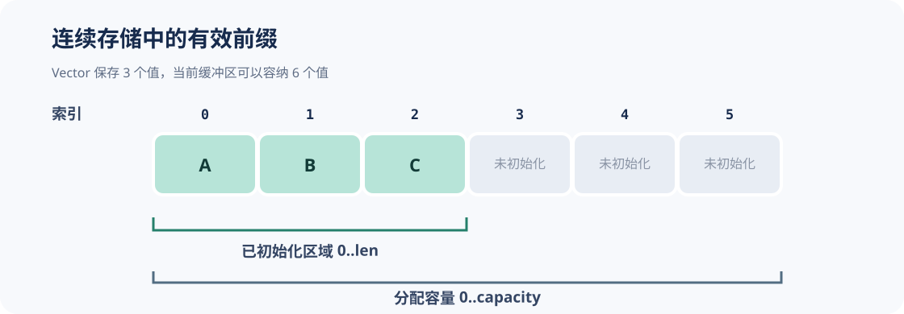
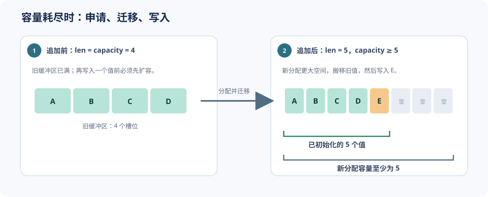

# 动态数组：`Vector<T>`

动态数组把一段连续内存包装成可以增长的序列。它让按索引读取保持简单，也让尾部追加在摊还意义上很快；代价是容量耗尽时需要申请更大的内存，并搬移已有元素。

本章沿着仓库自己的 `Vector<T>` 实现，说明这个抽象如何落到 Rust 的所有权、借用和原始内存操作上。它是用于学习的实现，公开接口并不试图覆盖标准库 `Vec<T>` 的全部功能与优化。

::: {.callout-tip}
## 学完本章，你应该能够

- 区分长度、容量和已初始化元素的范围。
- 追踪一次追加、扩容、插入和删除如何改变数组状态。
- 解释为什么尾部追加是摊还 `O(1)`，而中间插入需要 `O(n)` 移动。
- 说清 `Vector<T>` 如何用 `len` 与 `Storage<T>` 管理元素的生命周期。
:::

## 从一个使用场景开始

假设我们要按顺序收集一批值，但一开始不知道最终会有多少个。固定长度数组要求长度提前确定；链表能逐节点增长，却不提供连续内存和常数时间的索引访问。动态数组在两者之间提供了一个常用选择：连续存放，按需扩大。

```rust
use data_structures::Vector;

let mut samples = Vector::new();
samples.push(12);
samples.push(18);
samples.push(25);

assert_eq!(samples.len(), 3);
assert_eq!(samples[1], 18);
assert_eq!(samples.pop(), Some(25));
```

这段代码展示了最常见的接口：在尾部加入元素、读取长度、按索引访问，以及移除最后一个元素。`Vector` 还提供切片视图、显式容量管理、任意位置插入与删除，以及共享、可变和消费迭代。

## 接口地图

| 需求 | API | 边界行为 |
|---|---|---|
| 创建空序列 | `Vector::new()` | 不申请元素缓冲区 |
| 预留容量 | `with_capacity` / `try_with_capacity` | 前者在容量溢出或分配失败时 panic；后者返回错误 |
| 为后续追加预留空间 | `reserve` / `try_reserve` | 参数是“在当前长度之外再预留多少个” |
| 添加元素 | `push` / `try_push` | fallible 版本会把未加入的元素一并交还 |
| 读取元素 | `get` / `get_mut` | 越界返回 `None` |
| 索引读取 | `v[i]` | 越界 panic，语义与切片索引一致 |
| 移除末尾 | `pop` | 空序列返回 `None` |
| 插入到位置 | `insert(i, value)` | 要求 `i <= len`，否则 panic；后续元素右移 |
| 按位置删除 | `remove(i)` | 越界返回 `None`；后续元素左移并保持顺序 |
| 快速删除 | `swap_remove(i)` | 越界返回 `None`；用末尾元素补位，顺序可能变化 |
| 查看连续数据 | `as_slice` / `as_mut_slice` | 只暴露已初始化的元素 |
| 遍历 | `iter` / `iter_mut` / 消费迭代 | 按序读取；消费迭代移交元素所有权 |

当索引来自输入、文件或计算结果时，优先用 `get` 表达“可能不存在”。`Index` 适合已由程序逻辑保证有效的索引；它不会把越界错误转换成 `Option`。

### 与 Rust 标准接口配合

`Vector<T>` 实现了 `Default`、`Clone`、`Debug`、相等比较、`Deref<Target = [T]>`、索引、`FromIterator`、`Extend` 和数组转换。它也支持三种常见遍历形式：

```rust
use data_structures::Vector;

let mut values = Vector::from([3, 1, 4]);
let borrowed: Vec<_> = values.iter().copied().collect();
assert_eq!(borrowed, [3, 1, 4]);

for value in &mut values {
    *value *= 2;
}
let owned: Vec<_> = values.into_iter().collect();
assert_eq!(owned, [6, 2, 8]);
```

`Deref` 让切片的方法可以直接用于 `Vector`，例如 `values.sort()` 和 `values.first()`。这让接口更符合 Rust 使用习惯，同时也意味着向量的一些行为来自切片 API，而非 `Vector` 自己定义的方法。

## 长度与容量是两件事

`len` 是当前序列中元素的个数。`capacity` 是缓冲区目前可以容纳的元素个数。容量超出长度的部分是预留空间，不是可以访问的值。

下图表示长度为 3、容量为 6 的序列。只有索引 `0..3` 内有初始化的 `T`；其余槽位只是可用于未来写入的存储空间。

{#fig-vector-layout width=95%}

这一区分决定了实现的核心状态不变量：

> `0..len` 中的每个位置都包含一个有效的 `T`；`len..capacity` 中没有有效的 `T`。

`Vector<T>` 将状态分在两个字段里：`Storage<T>` 持有指针和容量，`Vector<T>` 自己持有逻辑长度。长度同时告诉实现哪些元素需要借用、移动或析构。

## 尾部追加与扩容

`push` 的流程可以概括为两步：先确保至少有一个空槽位，再把值写进 `len` 位置并增加长度。若当前容量已够，追加只处理末尾；如果容量不足，实现会分配更大的缓冲区并迁移已有元素。

在当前实现中，普通非零大小类型的初始容量至少为 4；后续空间不足时按几何方式增长。图中展示从满载的 4 个槽位追加第五个元素的状态变化。

{#fig-vector-growth width=100%}

实际操作序列如下：

```rust
use data_structures::Vector;

let mut values = Vector::new();
for value in [4, 8, 15, 16] {
    values.push(value);
}

assert_eq!(values.len(), 4);
assert!(values.capacity() >= values.len());

values.push(23); // 容量不足时先扩容
assert_eq!(values.as_slice(), &[4, 8, 15, 16, 23]);
```

这里检查 `capacity() >= len()`，而不依赖容量恰好等于 4 或 8。增长策略属于当前实现细节，调用者应使用 `capacity` 判断“现在还能否追加而不扩容”，不要把某一轮增长的精确数值当作 API 保证。

### 为什么追加是摊还 `O(1)`

一次普通追加只写一个尾部槽位，耗时 `O(1)`。扩容时则需要把已有 `n` 个元素迁移到新缓冲区，单次操作耗时 `O(n)`。几何增长让扩容不会每次追加都发生：把很多次追加的成本平均到每个元素上，尾部追加的摊还成本为 `O(1)`。

“摊还”描述一串操作的平均成本，不表示每次 `push` 都是常数时间。如果程序能预估元素数量，可以用 `with_capacity` 或 `reserve` 提前申请空间，减少中途扩容。

### 零大小类型

当 `T` 不占用内存（例如 `()`）时，多个元素不需要各自占一段字节。当前实现不为零大小类型申请缓冲区，并把逻辑容量设为 `usize::MAX`；`len` 仍然记录存入了多少个值，迭代和析构也仍遵守元素数量。这里的“容量很大”是布局优化，不表示长度可以越过 `usize` 的边界。

## 中间插入与删除

在索引 `i` 插入时，索引 `i..len` 的元素要向右移动一个位置；删除时，`i+1..len` 的元素向左补位。因此两者的移动成本取决于位置：

- `insert(i, value)` 需要移动 `len - i` 个元素。
- `remove(i)` 需要移动 `len - i - 1` 个元素。
- `swap_remove(i)` 用最后一个元素覆盖 `i`，不保持顺序，适合“顺序无关紧要”的场景。

例如，删除 `[a, b, c, d]` 中的 `b`，`remove(1)` 会得到 `[a, c, d]`；`swap_remove(1)` 会得到 `[a, d, c]`。两者接口名称不同，是为了把顺序保证写在选择里。

## 元素何时被销毁

`Vector` 拥有其中每一个 `T`。`pop`、`remove` 和消费迭代会把元素的所有权交给调用者；`clear` 与 `truncate` 会销毁被移除的元素；`Drop` 则负责销毁仍留在向量中的元素，并释放缓冲区。

容量范围里的未初始化槽位不是元素，因此不会调用 `T` 的析构函数。这个规则对带有资源的值尤其重要：例如文件句柄、`String` 或 `Box<T>`，每个已初始化值都必须恰好销毁一次。

## 实现中的安全不变量

本项目选择自行管理原始分配，以展示 `Vector` 的内存模型。这里的 `unsafe` 操作由几个相互配合的约束支撑：

1. `Storage<T>` 负责持有与释放分配，容量与分配布局一致。
2. `Vector<T>::len` 记录已初始化区域的结束位置。
3. 读取、借用或析构元素前，索引必须落在 `0..len`。
4. 写入新值后才增加 `len`；移交或销毁末尾值前先减少 `len`，避免析构期间重复处理该位置。
5. 扩容只复制已初始化的 `len` 个元素，并将旧分配释放一次。

以 `pop` 为例，先把长度减一，再从原来的末尾位置读出拥有值。之后 `Vector::drop` 只会看到更短的初始化区间。`IntoIter` 也采用相似策略：迭代器记录尚未移交的前后边界，析构时只销毁未产出的元素。

这些约束不是 `unsafe` 代码的装饰性注释，而是每个指针操作成立的前提。阅读实现时，可以沿着“哪个字段证明索引有效”“长度何时改变”“谁负责最后一次 drop”这三个问题追踪。

## 复杂度速查

设 `n = len`，`i` 为位置索引。

| 操作 | 时间 | 说明 |
|---|---:|---|
| `len`、`capacity`、`get`、`get_mut` | `O(1)` | 索引检查和访问 |
| `push` | 摊还 `O(1)`；扩容时 `O(n)` | 几何增长 |
| `pop` | `O(1)` | 只处理最后一个元素 |
| `insert(i, value)` | `O(n-i)` | 向右移动后续元素 |
| `remove(i)` | `O(n-i)` | 向左移动后续元素 |
| `swap_remove(i)` | `O(1)` | 不保留顺序 |
| `clear` / `truncate` | 按销毁元素数计 `O(n)` | 保留已分配容量 |
| 遍历 | `O(n)` | 连续访问所有元素 |

## 源码导读

| 文件 | 负责的内容 | 阅读问题 |
|---|---|---|
| `src/linear/vector.rs` | 类型状态、公共方法和核心算法 | 哪些操作会改变 `len`？哪些会改变分配？ |
| `src/linear/vector/storage.rs` | 原始分配、扩容和释放 | 扩容失败时旧状态为什么仍有效？ |
| `src/linear/vector/iter.rs` | 借用与消费迭代 | 已产出的元素如何避免再次析构？ |
| `src/linear/vector/traits.rs` | `Clone`、`Deref`、索引、集合构造等 trait | 哪些标准接口委托给切片？ |
| `src/linear/vector/errors.rs` | fallible 操作的错误类型 | `try_push` 失败时如何取回传入值？ |

## 与标准库 `Vec<T>` 的关系

学习实现应让主要状态和算法容易追踪。标准库 `Vec<T>` 是成熟通用容器，提供更广的 API 与经过长期优化的实现。实际应用通常优先使用标准库；本项目的 `Vector<T>` 用来理解连续存储、容量增长和元素生命周期。

## 练习

1. 从空向量开始连续追加 5 个 `u8`。记录每一步的 `len` 与 `capacity`，再解释为什么程序不应依赖某个固定容量序列。
2. 对 `[2, 3, 5, 7, 11]` 执行 `insert(2, 4)` 与 `remove(1)`，画出每次移动前后的索引。
3. 找出 `truncate`、`pop`、`remove` 和 `IntoIter::drop` 中长度或迭代边界改变的位置。每处改变避免了哪一种重复访问或重复析构？
4. 用一个带 `Drop` 的小类型记录析构次数，分别验证 `clear`、`truncate`、`pop` 和部分消费后的迭代器析构行为。

## 本章小结

`Vector<T>` 的核心是“连续分配 + 初始化前缀”。`len` 标记哪些槽位拥有有效值，`capacity` 描述还能容纳多少值；几何扩容换来摊还常数时间的尾部追加，中间修改则需要搬移元素。Rust 的所有权约束与显式析构规则贯穿分配、迭代和释放的整个生命周期。

